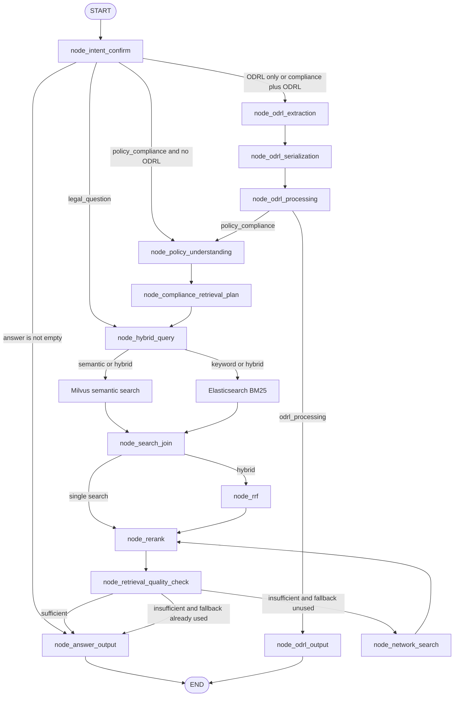
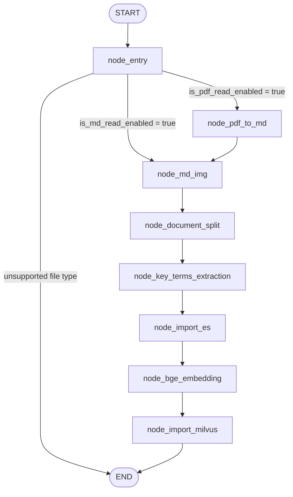
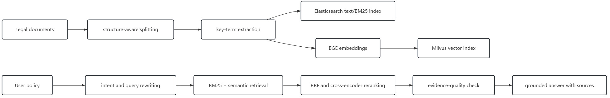

# LexLegal — AI Legal Compliance RAG Assistant

LexLegal is an evidence-grounded legal-compliance assistant for analysing
organisational policies, contracts, processes, and technical practices against
applicable legislation. It also answers ordinary legal questions and can
optionally transform natural-language policy rules into validated W3C ODRL 2.2
JSON-LD.

The central question LexLegal is designed to answer is:

> Does this policy contain the rules, responsibilities, safeguards,
> procedures, and evidence required by the applicable law?

LexLegal is not intended to return only “compliant” or “non-compliant.” It aims
to produce a traceable assessment showing the supplied policy evidence,
relevant legal provisions, gaps or ambiguity, and recommended corrections.

Example:

```text
Policy: Personal data will be retained for as long as required by the business.

Assessment: The wording recognises retention but does not define an objective
retention period, deletion trigger, responsible owner, deletion or
anonymisation procedure, or a documented exception process.

Recommended correction: Define a retention schedule by data category,
including its trigger, duration, owner, deletion procedure, evidence, and
legal-hold exceptions.
```

> LexLegal is a decision-support and research system. Its output is not a
> substitute for advice from a qualified legal professional.

## What LexLegal Does

### Ordinary legal questions

For questions such as:

```text
What does the GDPR storage-limitation principle require?
```

LexLegal rewrites the question for retrieval, searches the legal knowledge
base, reranks the evidence, checks its quality, and generates a source-grounded
answer.

### Policy-compliance assessment

For a supplied organisational policy or practice, LexLegal:

1. identifies the policy's purpose and operational context;
2. extracts source-grounded permissions, obligations, prohibitions,
   responsibilities, constraints, and procedures;
3. creates a legal-evidence retrieval plan for each atomic policy rule;
4. retrieves relevant articles, paragraphs, recitals, definitions, annexes,
   and controlled network evidence;
5. compares the policy with the retrieved legal requirements;
6. identifies addressed, partial, missing, conflicting, or ambiguous
   requirements;
7. produces findings, citations, limitations, and recommended corrections.

### ODRL processing

When the user explicitly requests ODRL analysis, LexLegal:

1. calls a specialised ODRL extraction endpoint;
2. independently extracts the same rules with an AI model;
3. compares, source-validates, and reconciles both results;
4. generates atomic `validated_policy_rules`;
5. serializes them as `odrl_jsonld_document` in W3C ODRL 2.2 JSON-LD;
6. validates the document through an ODRL Engine;
7. makes at most one diagnostic-guided AI repair attempt if validation fails.

ODRL serialization is a mandatory internal part of ODRL analysis, not a
separate user task. Compliance-only requests do not call the ODRL endpoint,
serializer, or engine. A combined compliance-plus-ODRL request performs ODRL
processing once and reuses the extracted rules and context for compliance
retrieval.

## Supported Query Routes

`node_intent_confirm` uses recent conversation history and a JSON-mode AI model
to classify each message. Backend normalization then selects one of four graph
destinations:

| Condition after normalization | Next node |
|---|---|
| A direct or clarification answer is already present | `node_answer_output` |
| Ordinary `legal_question` | `node_hybrid_query` |
| `policy_compliance` without requested ODRL analysis | `node_policy_understanding` |
| ODRL-only processing or compliance plus requested ODRL analysis | `node_odrl_extraction` |

The classification has two levels:

```text
intent
├── legal_retrieval
│   ├── legal_question
│   ├── odrl_processing
│   └── policy_compliance
├── clarification_needed
└── general_conversation
```

## Query Process Workflow

The query process converts a user message into either a direct response, an
ODRL result, an ordinary evidence-grounded legal answer, or a structured
policy-compliance assessment. The graph runs only the branches required by the
normalized intent and requested outputs.



The network fallback runs at most once. If evidence remains weak, the answer
reports the limitation rather than entering a search loop or presenting an
unsupported conclusion.

The main query stages are:

1. **Intent and query preparation:** load recent conversation history,
   classify the message, isolate policy text, rewrite the query, extract legal
   terms, and save the user message.
2. **Optional policy or ODRL understanding:** compliance-only requests extract
   policy rules and context once; explicit ODRL requests additionally run dual
   extraction, reconciliation, JSON-LD serialization, and engine validation.
3. **Compliance retrieval planning:** convert each atomic policy rule into a
   traceable legal-evidence request and construct the combined query currently
   consumed by the retrieval nodes.
4. **Local retrieval:** run Milvus semantic search, Elasticsearch BM25, or both
   in parallel according to `search_type`.
5. **Fusion and reranking:** use RRF for hybrid results and a BGE cross-encoder
   to retain the strongest evidence.
6. **Quality control:** accept sufficient evidence, perform one controlled web
   fallback, or report that authoritative evidence remains insufficient.
7. **Answer and persistence:** stream the response through SSE, disclose
   sources, save the assistant message, and persist the terminal query graph
   state with its session and query-run identifiers.

For detailed routing conditions, see the [main query workflow](docs/9.main_query_workflow-v4.md)
and [`node_intent_confirm` reference](docs/10.node_intent_confirm.md).

## Law Import Process Workflow

The import process converts PDF or Markdown legislation into reproducible text
and vector records used by the query workflow.



### Import stages

| Stage | Responsibility | Main output |
|---|---|---|
| `node_entry` | Validate the source path, identify PDF or Markdown, derive the document title, and initialize routing flags | `pdf_path` or `md_path`, `file_title` |
| `node_pdf_to_md` | Upload PDF input to MinerU, poll for conversion, download the result archive, and select the generated Markdown | `md_path`, Markdown content and extracted assets |
| `node_md_img` | Find referenced images, use surrounding context and a vision model to create descriptions, upload images to MinIO, and replace local links with persistent URLs | Rewritten `md_content` and accessible image URLs |
| `node_document_split` | Parse legal hierarchy and create stable parent and child records with hashes and metadata | `chunks` |
| `node_key_terms_extraction` | Generate legal key terms for searchable child records and preserve parent-child metadata | Enriched `chunks` |
| `node_import_es` | Create or validate the index, upsert all parent and child text records, and remove stale records for the same law | Elasticsearch legal-text records |
| `node_bge_embedding` | Select non-empty child records, verify vector dimensions, and generate dense vectors in batches | `embeddings_content` |
| `node_import_milvus` | Create or validate the collection, upsert child vectors by stable `chunk_id`, and remove stale vector records | Milvus vector records |

### PDF and Markdown routes

A PDF follows:

```text
node_entry
  → node_pdf_to_md
  → node_md_img
  → node_document_split
  → node_key_terms_extraction
  → node_import_es
  → node_bge_embedding
  → node_import_milvus
```

A Markdown document skips conversion:

```text
node_entry
  → node_md_img
  → node_document_split
  → node_key_terms_extraction
  → node_import_es
  → node_bge_embedding
  → node_import_milvus
```

Unsupported file types terminate after `node_entry` and are not indexed.

### Storage contract

Elasticsearch stores the authoritative parent and child text, metadata, and
key terms used by BM25 retrieval. Milvus stores embeddings for searchable
child chunks; the stable `parent_id` allows a retrieved child to be related
back to its broader article context. MinIO stores document images so they
remain accessible outside the import container.

Both database import nodes use stable chunk identifiers and idempotent upserts.
After a law is re-imported, records from the older version that are not present
in the new chunk set are removed. This prevents duplicate and stale legal
evidence from accumulating.

## Legal Knowledge-Base Ingestion

LexLegal processes PDF or Markdown legal documents through a LangGraph
ingestion workflow. It preserves legal hierarchy rather than relying only on
arbitrary fixed-size windows:

- chapters and sections;
- articles and article titles;
- numbered paragraphs;
- points and subpoints;
- recitals;
- definitions;
- annexes.

Articles can be stored as parent chunks while paragraphs or bounded point
groups become child chunks. The ingestion workflow also provides:

- stable legal chunk identifiers;
- parent-child relationships;
- document and chunk hashes;
- idempotent Elasticsearch and Milvus upserts;
- stale-record removal;
- legal metadata and key-term enrichment;
- BGE dense embeddings.

This supports precise evidence retrieval while retaining the broader legal
context of the parent article.

## Retrieval and Evidence Quality

LexLegal uses a staged retrieval architecture:

1. **Elasticsearch BM25** retrieves exact legal terminology, named laws,
   duties, actors, and distinctive statutory wording.
2. **Milvus dense-vector search** retrieves semantically related provisions
   when policy and legal language use different terms.
3. **Reciprocal Rank Fusion** combines both rankings without assuming their raw
   scores share a scale.
4. **BGE cross-encoder reranking** evaluates query-document relevance more
   precisely over the strongest candidates.
5. **Source-aware quality gating** applies different acceptance thresholds to
   curated legal records and open-web evidence.
6. **Tavily MCP fallback** performs one controlled network search when local
   evidence is insufficient, followed by reranking and another quality check.

## Why the Project Is Distinctive

The project does not claim that RAG, LangGraph, hybrid search, or ODRL is
individually new. Its contribution is their integration into a traceable legal
policy-assessment workflow.

Key differentiators include:

- **Legal-structure-aware ingestion:** articles, paragraphs, points, recitals,
  definitions, and annexes remain identifiable and traceable.
- **Rule-aware compliance retrieval:** one policy sentence can become several
  atomic rules, each with its own legal-evidence retrieval request.
- **Independent dual ODRL extraction:** specialised and AI outputs are compared
  without one anchoring the other, and disagreements remain auditable.
- **Validated machine-readable policy:** extracted rules can become W3C ODRL
  2.2 JSON-LD and pass through external validation and bounded repair.
- **Task-aware efficiency:** compliance-only queries avoid formal ODRL work;
  combined requests reuse the completed extraction instead of running it twice.
- **Source-aware evidence control:** curated and network sources use different
  thresholds, provenance, and warnings.
- **End-to-end traceability:** stable chunks, policy evidence, extraction audit
  logs, citations, conversations, and per-query graph snapshots connect the
  original request to the final output.

## Application Architecture



| Layer | Main components |
|---|---|
| Frontend | Vue 3, Vite, authenticated legal-compliance workspace, import and monitoring views |
| API | Unified FastAPI application with authentication, legal-query, and document-import routers |
| Workflow | LangGraph query and ingestion graphs |
| Retrieval | Elasticsearch BM25, Milvus dense vectors, RRF, BGE reranker |
| Persistence | MongoDB conversation history and query graph snapshots |
| Authentication | Keycloak login and role-aware access |
| ODRL | Extraction endpoint, deterministic JSON-LD serializer, ODRL Engine validation |
| Streaming | Server-Sent Events for progress and answer deltas |

## User Access

Keycloak authentication protects the application:

- ordinary users can access the Legal Compliance workspace;
- administrators can also import legal documents and access query monitoring.

Conversations are associated with the authenticated user. The frontend allows
users to start a new conversation, reopen an earlier session, and continue it.

## Unified API

The FastAPI application combines authentication, legal-query, and import
routers on port `8008`:

```text
/api/*          Authentication APIs
/api/query/*    Legal Compliance APIs
/api/import/*   Legal Document Import APIs
/health         Service health
/docs           OpenAPI/Swagger documentation
```

Swagger UI groups the routes into **Authentication APIs**, **Legal Compliance
APIs**, and **Legal Document Import APIs**.

## Run Locally

### Requirements

- Python 3.11 or later;
- Node.js suitable for the Vite frontend;
- configured `.env` values;
- reachable Elasticsearch, Milvus, MongoDB, Keycloak, embedding, reranking,
  LLM, and optional ODRL services required by the selected workflow.

Install the locked Python environment with `uv`:

```bash
uv sync --frozen
```

Start the unified API:

```bash
uv run python -m uvicorn app.api.lex_legal_api:app \
  --host 0.0.0.0 \
  --port 8008
```

Open:

```text
API health: http://localhost:8008/health
Swagger UI: http://localhost:8008/docs
```

Start the Vue frontend:

```bash
cd lex-legal_frontend
npm ci
npm run dev -- --host 0.0.0.0 --port 5176
```

Open the frontend at:

```text
http://localhost:5176
```

## Run with Docker Compose

The repository Compose file starts the unified API on port `8008` and the
Vue/Vite frontend on port `5176`. Backend databases and model services are
expected to be available on the external `dips-local` network.

Create the network once if it does not exist:

```bash
docker network inspect dips-local >/dev/null 2>&1 \
  || docker network create dips-local
```

Build and start LexLegal:

```bash
docker compose up --build
```

The API container starts with:

```bash
python -m uvicorn app.api.lex_legal_api:app \
  --host 0.0.0.0 \
  --port 8008 \
  --reload
```

See [Docker configuration](docs/docker.md) for service URLs, endpoint
configuration, and production considerations.

## Build the Legal Knowledge Base

Import every supported document in a directory:

```bash
python -m app.scripts.build_rag_knowledge_base ./law_doc/laws \
  --output-dir ./output/laws_build
```

The same CLI accepts a single Markdown file. The administrator import API and
frontend provide an alternative interactive import route.

## Current Limitations

- Applicability analysis still depends on supplied jurisdiction, legal role,
  sector, activity, and other context; missing facts must not be invented.
- Retrieval quality depends on the legislation and metadata imported into the
  knowledge base.
- Policy and ODRL extraction use probabilistic models and still require human
  review for high-impact decisions.
- The deterministic ODRL serializer supports a conservative subset of W3C ODRL
  rather than every vocabulary feature and logical relationship.
- Network evidence is less authoritative than curated legal records and is
  explicitly disclosed as fallback evidence.

## Technology Stack

- Python 3.11
- FastAPI and Uvicorn
- LangGraph and LangChain
- Vue 3, TypeScript, and Vite
- Elasticsearch
- Milvus
- MongoDB
- Keycloak
- BGE embeddings and cross-encoder reranking
- OpenAI-compatible language models
- Tavily MCP
- W3C ODRL JSON-LD and ODRL Engine validation
- Docker Compose
