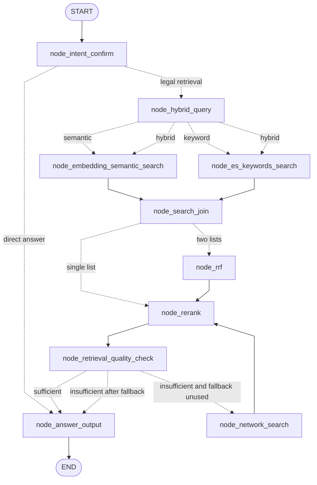
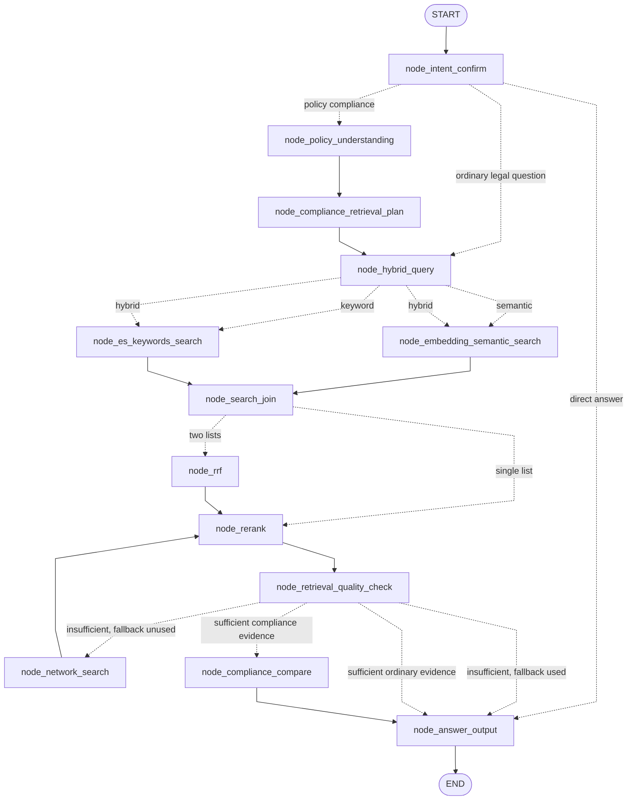
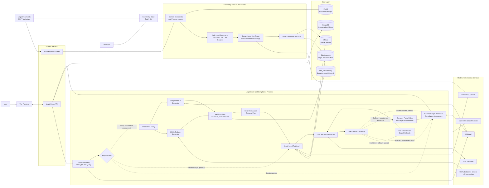
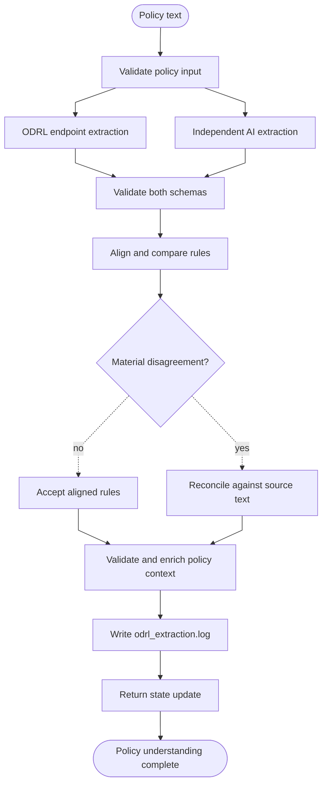

# Query Policy Understanding and Compliance Assessment

## Document status

This document records the design discussion for extending the Lex-Legal query
workflow from legal question answering to structured policy compliance
assessment. It describes a proposed architecture; the policy-understanding,
compliance-planning, and compliance-comparison nodes described here are not yet
part of the production query graph unless explicitly implemented later.

## 1. Objective

Legal compliance means checking whether an organisation's policy, process,
contract, or technical practice follows the laws and regulations that apply to
it. The central question is:

> Does the policy contain the rules, responsibilities, safeguards, procedures,
> and evidence required by the applicable law?

The required output is not merely `compliant` or `non-compliant`. A useful
assessment must identify what the policy says, retrieve the relevant legal
requirements, compare the two, explain gaps or conflicts, and recommend
specific corrections.

The proposed extension therefore has four broad responsibilities:

1. Understand and structure the supplied policy.
2. Determine what legal evidence must be retrieved.
3. Compare policy rules with retrieved legal requirements.
4. Produce an evidence-grounded, structured compliance report.

## 2. Questions resolved by this design

### 2.1 Is `node_intent_confirm` sufficient for understanding a policy?

No. The current intent node classifies a message, resolves conversational
references, rewrites it as a standalone retrieval query, and extracts legal
search terms. It does not decompose policy language into permissions,
obligations, prohibitions, actions, assets, actors, constraints, and purposes.

Policy understanding should therefore be a separate stage after intent
classification and before legal retrieval planning.

### 2.2 Should every legal query go through policy understanding?

No. Ordinary legal questions have no policy document or organisational rule to
evaluate. They should continue directly to the existing retrieval workflow.
Only requests classified as policy compliance assessments should enter the new
policy-understanding branch.

### 2.3 Should the ODRL endpoint result simply be given to an AI model for correction?

That approach can produce a usable corrected result with lower complexity, but
it is unsuitable for unbiased model evaluation. An AI model that sees the ODRL
prediction before extracting rules can become anchored to it, preserve its
mistakes, and overlook rules that the endpoint omitted.

Because a project objective is to improve the ODRL extraction model, the chosen
design uses two independent predictions:

- the existing ODRL extraction endpoint;
- an independent AI extraction from the original policy text.

Only after both raw outputs have been preserved are they aligned, compared,
and reconciled.

### 2.4 Is the AI extraction ground truth?

No. The AI output is another prediction. Agreement is useful evidence, and
disagreement is useful for error analysis, but neither output automatically
becomes a gold annotation. Material conflicts should be reconciled cautiously
and may require human review.

### 2.5 Why name the new stage `node_policy_understanding`?

`node_odrl_extraction` would describe only one implementation detail. The
broader node must also validate predictions, compare independent extractions,
identify contextual entities, preserve missing information, and construct the
state needed by compliance retrieval. `node_policy_understanding` therefore
better describes its responsibility.

## 3. Ordinary legal question versus policy compliance assessment

Both request types may require legal retrieval, but they have different inputs,
reasoning operations, and expected outputs.

### 3.1 Ordinary legal question

An ordinary legal question asks what the law says, permits, prohibits, or
requires.

Examples:

- "How long may personal data be retained under the GDPR?"
- "What obligations does a data controller have?"
- "Can personal data be processed for academic research?"
- "What does Article 5 of the GDPR require?"
- "Does the EU Data Act apply to connected products?"

Its basic operation is:

```text
User question -> relevant legal provisions -> legal explanation
```

There is no policy rule to decompose or compare, so ODRL extraction is normally
unnecessary.

### 3.2 Policy compliance assessment

A policy compliance assessment asks whether supplied policy wording, a
process, a contract, or a technical practice satisfies applicable legal
requirements.

Examples:

- "Assess this retention policy for GDPR compliance."
- "Is this data-sharing rule compliant?"
- "Review our employee-monitoring policy."
- "Our company keeps customer information for as long as the business needs
  it. Is this sufficient?"
- A policy document pasted or uploaded through a compliance-analysis GUI.

Its basic operation is:

```text
What the policy says + what applicable law requires -> compliance findings
```

| Characteristic | Ordinary legal question | Policy compliance assessment |
|---|---|---|
| Main input | Question | Policy, rule, process, contract, or practice |
| Objective | Explain the law | Evaluate supplied wording against the law |
| ODRL extraction | Normally unnecessary | Useful |
| Retrieval basis | Rewritten question | Each atomic policy rule and missing context |
| Comparison stage | Normally unnecessary | Required |
| Output | Evidence-grounded legal explanation | Findings, gaps, conflicts, and corrections |

### 3.3 Ambiguous input

The sentence "Research data is retained for 30 days" does not state whether
the user wants an assessment or is merely providing background information.

In a dedicated compliance GUI, the interface mode can set the task type
explicitly. In a general chat interface, the assistant should ask whether the
user wants a compliance assessment or an explanation of the applicable legal
requirements.

### 3.4 State distinction

Intent and task type should be separate concepts:

```python
intent = "legal_retrieval"
task_type = "legal_question"
```

or:

```python
intent = "legal_retrieval"
task_type = "policy_compliance"
```

`intent` determines whether evidence retrieval is required. `task_type`
determines whether the system explains the law or compares a policy with it.

## 4. Current query workflow

The current graph supports direct answers, local legal retrieval, hybrid rank
fusion, reranking, evidence-quality checks, a one-time network fallback, and
grounded answer generation.



This graph can answer a question about a policy, but it does not explicitly
represent the policy or produce one finding per policy requirement.

## 5. Proposed top-level workflow

The existing legal-question route remains unchanged. A new conditional branch
handles policy compliance assessment.



### 5.1 Whole Lex-Legal workflow

The following system-level view combines legal-document ingestion, the existing
question-answering path, the proposed policy-compliance path, external model
services, and persistent storage.



The batch CLI enters the same knowledge-build pipeline as the import API but
does not need to call the HTTP import endpoint. MinIO stores image objects;
Elasticsearch remains the authoritative legal-text and BM25 store; Milvus
stores dense vectors; and MongoDB stores conversation history. The audit log is
separate from application logs because it preserves paired extraction results
for later evaluation.

The top-level routes are therefore:

```text
General conversation or clarification
    -> node_answer_output

Ordinary legal question
    -> existing retrieval workflow
    -> evidence-grounded legal answer

Policy compliance assessment
    -> node_policy_understanding
    -> node_compliance_retrieval_plan
    -> existing retrieval workflow
    -> node_compliance_compare
    -> structured compliance answer
```

## 6. Internal `node_policy_understanding` workflow

The node can initially be implemented as one public LangGraph node containing
independently testable functions. It may later become a compiled subgraph if
separate progress reporting and retry routes are useful.



The independent external calls should run concurrently:

```python
odrl_result, llm_result = await asyncio.gather(
    extract_with_odrl_endpoint(policy_text),
    extract_independently_with_llm(policy_text),
)
```

The independent AI prompt must contain the original policy and its own schema,
but not the ODRL endpoint prediction. A later reconciliation call may see both
predictions because independence has already been preserved.

## 7. ODRL and AI extraction responsibilities

### 7.1 ODRL endpoint extraction

The existing endpoint accepts:

```json
{
  "text": "Policy or contract text"
}
```

and returns rules with these fields:

```json
{
  "rules": [
    {
      "source_text": "...",
      "assignee": "...",
      "action": "...",
      "asset": "...",
      "rule_type": "permission",
      "constraint": "...",
      "purpose": "..."
    }
  ]
}
```

The endpoint provides the project's specialised model prediction. Its raw
result must be retained unchanged for evaluation.

### 7.2 Independent AI extraction

For fair rule comparison, the AI initially returns the same core rule fields.
It can also return contextual information that lies outside the ODRL endpoint's
current schema:

```json
{
  "rules": [],
  "policy_context": {
    "purposes": [],
    "organisations": [],
    "legal_roles": [],
    "business_activities": [],
    "systems": [],
    "data_categories": [],
    "people": [],
    "jurisdictions": [],
    "procedures": [],
    "missing_context": []
  }
}
```

Every contextual value should identify whether it is explicit, inferred, or
missing:

```json
{
  "value": "academic researchers",
  "evidence": "for academic research only",
  "provenance": "inferred",
  "confidence": 0.72
}
```

The AI must not invent an organisation, assignee, jurisdiction, or legal role.
For example, it must not infer that EU law applies merely because Lex-Legal
contains EU legislation.

## 8. Atomic-rule example

Consider this policy sentence:

> The document may be downloaded once and retained for 30 days for academic
> research only.

A weak extraction may collapse it into one rule and attach the retention
duration to downloading:

```json
{
  "rules": [
    {
      "source_text": "The document may be downloaded once and retained for 30 days for academic research only.",
      "assignee": "",
      "action": "may be downloaded",
      "asset": "The document",
      "rule_type": "permission",
      "constraint": "for 30 days",
      "purpose": "for academic research only"
    }
  ]
}
```

A stronger atomic representation contains two governed actions:

```json
{
  "rules": [
    {
      "source_text": "The document may be downloaded once and retained for 30 days for academic research only.",
      "assignee": "",
      "action": "download",
      "asset": "The document",
      "rule_type": "permission",
      "constraint": "once",
      "purpose": "academic research only"
    },
    {
      "source_text": "The document may be downloaded once and retained for 30 days for academic research only.",
      "assignee": "",
      "action": "retain",
      "asset": "The document",
      "rule_type": "permission",
      "constraint": "for 30 days",
      "purpose": "academic research only"
    }
  ]
}
```

This example demonstrates why comparison must support one-to-many rule
alignment and why the final action should distinguish the modal expression from
the normalized action. A future schema may retain both:

```json
{
  "raw_action": "may be downloaded",
  "action": "download",
  "rule_type": "permission"
}
```

## 9. Validation, alignment, and comparison

### 9.1 Schema validation

Before comparison, both predictions should be validated with the same typed
schema. Validation should cover:

- allowed rule types such as permission, obligation, and prohibition;
- string fields and normalized whitespace;
- preservation of `source_text`;
- absence of unsupported extra fields;
- maximum policy and field sizes;
- empty values when the source does not supply a component.

Invalid results should be logged with an error and must not silently enter the
compliance state.

### 9.2 Rule alignment

Rules cannot be compared by list index. The endpoint and AI may change order or
split one compound sentence differently. Alignment should consider:

```text
source-text overlap
+ rule-type equality
+ action similarity
+ asset similarity
+ assignee similarity
+ constraint similarity
+ purpose similarity
```

The alignment layer must support one-to-one, one-to-many, and unmatched rules.

### 9.3 Comparison categories

Each aligned result should be classified as one of:

- `exact_match`;
- `partial_match`;
- `odrl_only`;
- `llm_only`;
- `conflict`;
- `unable_to_align`.

Example comparison:

```json
{
  "agreement": {
    "asset": true,
    "rule_type": true,
    "purpose": true
  },
  "differences": [
    {
      "type": "rule_count_mismatch",
      "odrl_value": 1,
      "llm_value": 2
    },
    {
      "type": "llm_only_action",
      "value": "retain"
    },
    {
      "type": "constraint_assignment",
      "odrl_value": "30 days attached to download",
      "llm_value": "once attached to download; 30 days attached to retain"
    }
  ],
  "review_required": true
}
```

## 10. Reconciliation

Raw endpoint and AI predictions are immutable. Reconciliation produces a third
representation rather than overwriting either input:

```text
odrl_extracted_rules     -> raw endpoint prediction
llm_extracted_rules      -> raw independent AI prediction
validated_policy_rules   -> reconciled downstream representation
```

Straightforward agreement can be accepted deterministically. A second AI call
should be reserved for material disagreements, reducing cost and latency:

```python
if comparison["requires_reconciliation"]:
    validated_rules = await reconcile_policy_extractions(
        policy_text,
        odrl_result,
        llm_result,
        comparison,
    )
else:
    validated_rules = accept_aligned_rules(odrl_result, llm_result)
```

Every reconciled component should remain traceable:

```json
{
  "field": "action",
  "value": "retain",
  "evidence": "retained for 30 days",
  "selected_from": "llm",
  "odrl_value": "",
  "llm_value": "retain",
  "confidence": 0.91,
  "review_required": false
}
```

Material uncertainty should produce `review_required: true` instead of a
confident but unsupported value.

## 11. Proposed query state additions

The compliance branch requires additional state while leaving current search
branch fields intact:

```python
task_type: Literal["legal_question", "policy_compliance"]
policy_text: str

odrl_extracted_rules: list[dict]
llm_extracted_rules: list[dict]
policy_extraction_comparison: dict
validated_policy_rules: list[dict]
policy_context: dict

compliance_retrieval_queries: list[dict]
candidate_laws: list[str]
compliance_findings: list[dict]
```

A representative policy-understanding update is:

```json
{
  "task_type": "policy_compliance",
  "policy_text": "The document may be downloaded once...",
  "odrl_extracted_rules": [],
  "llm_extracted_rules": [],
  "policy_extraction_comparison": {
    "matched_rules": [],
    "odrl_only_rules": [],
    "llm_only_rules": [],
    "conflicts": [],
    "requires_reconciliation": false
  },
  "validated_policy_rules": [],
  "policy_context": {
    "purposes": [],
    "organisations": [],
    "legal_roles": [],
    "business_activities": [],
    "systems": [],
    "data_categories": [],
    "people": [],
    "jurisdictions": [],
    "procedures": [],
    "missing_context": []
  }
}
```

## 12. Compliance retrieval planning

The existing retrieval nodes consume one rewritten query and a flat list of key
terms. Merely adding ODRL rules to state will not affect retrieval. The new
`node_compliance_retrieval_plan` must convert atomic rules and missing context
into legal evidence requests.

Example:

```json
{
  "compliance_retrieval_queries": [
    {
      "policy_rule_id": "policy-rule-1",
      "query": "legal requirements governing one-time document downloads for academic research",
      "key_terms": [
        "download permission",
        "academic research",
        "access restriction"
      ]
    },
    {
      "policy_rule_id": "policy-rule-2",
      "query": "legal requirements for retaining research documents for thirty days",
      "key_terms": [
        "retention period",
        "storage limitation",
        "academic research",
        "deletion procedure"
      ]
    }
  ]
}
```

An initial implementation may combine these into one enriched
`rewritten_query`. The stronger long-term design runs retrieval per atomic rule
and associates retrieved evidence with `policy_rule_id` so the later comparison
does not lose provenance.

Candidate laws are retrieval hypotheses, not final applicability conclusions.
The system must not state that a law applies until the relevant jurisdiction,
role, activity, and evidence support that conclusion.

## 13. Compliance comparison and expected output

`node_compliance_compare` joins each validated policy rule with its retrieved
legal provisions. It should classify findings using a controlled vocabulary:

- `addressed`;
- `partially_addressed`;
- `missing`;
- `conflict`;
- `ambiguous`;
- `not_determinable`.

`not_determinable` is required when information such as jurisdiction, legal
role, data type, or operational evidence is missing.

A finding may look like:

```json
{
  "policy_rule_id": "policy-rule-2",
  "policy_evidence": "retained for 30 days",
  "legal_evidence": [],
  "status": "partially_addressed",
  "assessment": "The policy states a duration but does not specify the retention trigger or deletion procedure.",
  "missing_requirements": [
    "retention trigger",
    "deletion or anonymisation procedure",
    "responsible owner",
    "documented exception process"
  ],
  "conflicts": [],
  "recommended_correction": "...",
  "confidence": 0.86
}
```

The final answer should contain:

1. Executive summary.
2. Policy evidence.
3. Applicable legal evidence and citations.
4. Finding status.
5. Assessment rationale.
6. Missing or conflicting elements.
7. Recommended corrective wording or operational measures.
8. Limitations and missing contextual information.

Example:

```markdown
### Policy evidence

"Personal data will be retained for as long as required by the business."

### Assessment

Partially addressed. The policy recognises retention but does not define an
objective period or deletion criteria.

### Missing elements

- Retention trigger
- Duration by data category
- Deletion or anonymisation procedure
- Responsible owner
- Legal-hold exception process

### Recommended correction

Create a retention schedule by data category and define the trigger, duration,
deletion procedure, responsible owner, and documented exception process.
```

## 14. `odrl_extraction.log`

Both raw predictions, their comparison, and the reconciled result should be
written to `logs/odrl_extraction.log`. The file should use JSON Lines: one
complete JSON object per policy-processing request.

Keeping both predictions in one atomic record avoids correlation problems when
multiple policy requests run concurrently.

```json
{
  "timestamp": "2026-08-06T10:15:00Z",
  "extraction_id": "uuid",
  "session_id": "session-id",
  "policy_hash": "sha256...",
  "source_text": "The document may be downloaded...",
  "odrl_extraction": {
    "rules": []
  },
  "independent_llm_extraction": {
    "rules": [],
    "policy_context": {}
  },
  "comparison": {
    "matched_rules": 0,
    "differences": [],
    "review_required": true
  },
  "validated_rules": [],
  "reconciliation_method": "llm_reconciliation",
  "metadata": {
    "odrl_model_version": "...",
    "llm_model": "...",
    "prompt_version": "policy-understanding-v1",
    "odrl_latency_ms": 120,
    "llm_latency_ms": 850
  },
  "errors": []
}
```

Recommended settings include:

```env
ODRL_AUDIT_LOG_ENABLED=True
ODRL_AUDIT_INCLUDE_SOURCE_TEXT=True
ODRL_AUDIT_RETENTION=30 days
```

The logger should use UTF-8, queued writes, rotation, and configured retention.
It must never include API keys, authentication headers, or the complete graph
state.

Policies may contain personal, commercially sensitive, or confidential text.
Full source logging therefore requires deliberate access control and retention
decisions. In production, source logging should be opt-in or moved to a secured
evaluation store.

## 15. Model-improvement lifecycle

AI agreement is diagnostic, not an objective performance measure. Reliable
model improvement requires reviewed examples:

```text
ODRL prediction + independent AI prediction
                |
                v
       Identify disagreements
                |
                v
        Human adjudication
                |
                v
       Approved gold annotation
                |
                v
       Retrain and evaluate model
```

Useful evaluation measures include:

- rule-count agreement;
- atomic-rule splitting accuracy;
- rule-type accuracy;
- per-field exact match;
- action, asset, and assignee precision/recall/F1;
- constraint and purpose precision/recall/F1;
- unmatched endpoint-rule rate;
- unmatched AI-rule rate;
- percentage of policies requiring human review.

The current endpoint returns flattened rules. For BERT/BiLSTM/CRF retraining,
an optional diagnostic response containing raw tokens, predicted BIO labels,
and model confidence would be more useful. Human-corrected token labels can be
fed back into sequence-labelling training more directly than flattened rule
objects.

## 16. Endpoint configuration

Within the shared Docker network, Lex-Legal should use a complete internal URL:

```env
ODRL_EXTRACTION_ENDPOINT=http://odrl-extraction:5001/odrl_generation
```

The incomplete value below has no URL scheme or port and should not be used
unless client code explicitly supplies them:

```env
ODRL_EXTRACTION_ENDPOINT=odrl-extraction/odrl_generation
```

For a Lex-Legal process running directly on the host, the corresponding URL is
normally:

```env
ODRL_EXTRACTION_ENDPOINT=http://127.0.0.1:5001/odrl_generation
```

The client should use an asynchronous HTTP connection, a bounded timeout, and
a limited retry policy. It should distinguish endpoint unavailability from an
empty but valid extraction.

## 17. Failure behaviour

Policy understanding must preserve useful partial results while avoiding false
certainty.

| Condition | Recommended behaviour |
|---|---|
| ODRL succeeds; AI succeeds | Compare and reconcile normally |
| ODRL fails; AI succeeds | Continue with AI result, log degraded mode, require review where appropriate |
| ODRL succeeds; AI fails | Preserve endpoint result, log degraded mode, avoid claiming independent validation |
| Both fail | Stop compliance comparison and return a clear processing limitation |
| Both return no rules | Distinguish a genuinely non-normative policy from extraction failure |
| Required jurisdiction or role missing | Ask for clarification or return `not_determinable` |
| Material conflict cannot be reconciled | Preserve both predictions and require human review |

Long policies should be divided by stable sections or clauses while preserving
source order and identifiers. Every extracted rule should retain a `source_text`
or source span so it can be traced back to the original policy.

## 18. Suggested implementation boundaries

The first implementation can expose one LangGraph node while retaining clear
internal stages:

```python
step_1_validate_policy_input()
step_2_run_independent_extractions()
step_3_validate_extraction_schemas()
step_4_align_and_compare_rules()
step_5_reconcile_policy_rules()
step_6_validate_and_enrich_policy_context()
step_7_write_odrl_audit_log()
step_8_return_state_update()
```

Suggested external functions are:

```python
async def extract_with_odrl_endpoint(policy_text: str) -> dict:
    ...


async def extract_independently_with_llm(policy_text: str) -> dict:
    ...


def compare_policy_extractions(
    odrl_rules: list[dict],
    llm_rules: list[dict],
) -> dict:
    ...


async def reconcile_policy_extractions(
    policy_text: str,
    odrl_result: dict,
    llm_result: dict,
    comparison: dict,
) -> list[dict]:
    ...
```

## 19. Testing strategy

The implementation should have offline unit tests for:

- ordinary legal questions bypassing policy understanding;
- policy assessments entering the policy branch;
- direct responses bypassing all retrieval nodes;
- endpoint and AI calls executing independently;
- malformed endpoint or AI responses;
- exact rule agreement;
- partial field agreement;
- one-to-many rule alignment;
- endpoint-only and AI-only rules;
- conditional reconciliation calls;
- missing organisation, role, and jurisdiction handling;
- one atomic audit record containing both raw outputs;
- policy source logging disabled by configuration;
- endpoint failure with successful AI fallback;
- both extractors failing;
- compliance findings retaining policy-rule and legal-evidence provenance;
- ordinary query answers retaining the existing behaviour.

Integration tests should mock external extraction and LLM calls by default.
Tests that invoke the real ODRL service or an external AI model should be
explicit manual tests because they depend on containers, model files, network
availability, and possible API cost.

## 20. Implementation sequence

A practical incremental sequence is:

1. Add `task_type` classification and routing tests.
2. Add policy-understanding state schemas and defaults.
3. Implement the asynchronous ODRL client.
4. Create and validate the independent AI extraction prompt.
5. Implement exact and partial rule comparison.
6. Add conditional reconciliation and provenance.
7. Add the dedicated JSON Lines audit log.
8. Add `node_policy_understanding` to the query graph.
9. Implement compliance retrieval planning.
10. Associate retrieved evidence with policy rule IDs.
11. Implement `node_compliance_compare`.
12. Add a compliance-specific answer prompt and structured report rendering.
13. Evaluate disagreements and establish human-adjudication procedures.

## 21. Final design decision

The agreed design is:

> Run the specialised ODRL endpoint and the AI model independently, preserve
> both raw results, compare them before reconciliation, and write one auditable
> record containing both predictions and the final structured representation.

This supports two goals simultaneously:

- stronger policy understanding for the compliance workflow;
- useful disagreement data for evaluating and improving the ODRL model.
