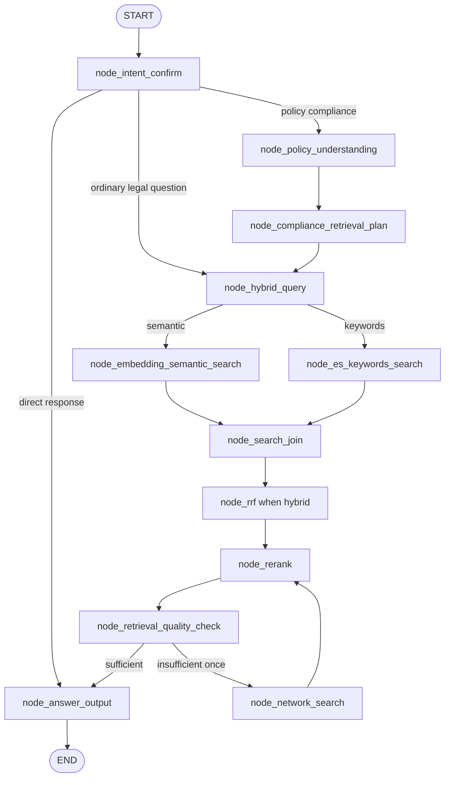
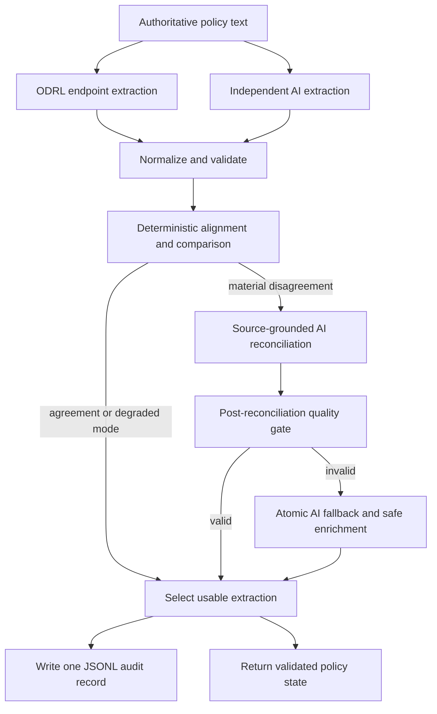

# Query Policy Understanding: Implementation Note

## 1. Purpose and status

This note documents the implemented policy-understanding and compliance-
retrieval-planning workflow in Lex-Legal. It is the implementation companion to
`docs/1.query_policy_understand.md`, which records the earlier design discussion.

Implemented components:

- policy-compliance intent classification;
- conditional routing for ordinary legal questions and policy assessments;
- an HTTP interface to the external ODRL extraction service;
- independent AI extraction from the original policy;
- normalization, validation, comparison, and conditional reconciliation;
- post-reconciliation quality validation and safe fallback;
- JSON Lines audit logging containing both extraction results;
- per-policy-rule legal retrieval planning;
- graph-state additions, progress labels, and focused tests.

Not yet implemented:

- executing a separate Elasticsearch and Milvus search for every policy rule;
- associating every retrieved legal provision with a particular policy rule;
- `node_compliance_compare` for producing addressed, partial, missing,
  conflicting, and ambiguous findings;
- a compliance-specific final report renderer.

## 2. Implemented workflow



The routing decision after `node_intent_confirm` is:

```python
if state.get("answer"):
    return "node_answer_output"
if state.get("task_type") == "policy_compliance":
    return "node_policy_understanding"
return "node_hybrid_query"
```

Therefore, the new policy nodes do not add latency to an ordinary legal
question.

## 3. Policy-compliance intent classification

### 3.1 Output fields

`node_intent_confirm` now returns:

```json
{
  "intent": "legal_retrieval",
  "task_type": "policy_compliance",
  "policy_text": "The policy wording that must be assessed.",
  "query_key_terms": [],
  "rewritten_query": "A retrieval-friendly version of the request.",
  "direct_answer": ""
}
```

`intent` and `task_type` have different responsibilities:

- `intent` decides whether legal evidence retrieval is needed;
- `task_type` decides whether policy understanding is needed before retrieval.

### 3.2 Policy commands and imperfect grammar

The prompt explicitly recognizes instructions such as:

```text
Compliance the policy: The document may be downloaded once and retained for
30 days for academic research only.
```

as `policy_compliance`. It also recognizes:

- `check this policy`;
- `compliance check this`;
- `assess this wording`;
- `review this contract`;
- `audit this process`;
- a bare normative statement that defines permitted, required, or prohibited
  conduct.

For an instruction followed by a colon, `policy_text` contains the policy
wording rather than the instruction prefix.

An ordinary legal question remains `legal_question`, for example:

```text
What retention period does the GDPR require?
```

The relevant prompt is:

```text
prompts/rewritten_query_and_key_terms.prompt
```

## 4. Query graph state additions

The following fields were added to `QueryGraphState` and its default state:

| Field | Purpose |
|---|---|
| `task_type` | Distinguishes `legal_question` from `policy_compliance`. |
| `policy_text` | Authoritative policy wording to be analysed. |
| `odrl_extracted_rules` | Normalized raw rules from the ODRL endpoint. |
| `llm_extracted_rules` | Normalized independent AI rules. |
| `policy_extraction_comparison` | Matches, differences, failures, and validation findings. |
| `validated_policy_rules` | Source-grounded rules selected for downstream retrieval. |
| `policy_context` | Validated purposes, organisations, roles, systems, and related context. |
| `policy_understanding_errors` | Degraded-mode and validation information. |
| `odrl_audit_log_path` | Location of the extraction audit log. |
| `compliance_retrieval_queries` | One legal-evidence request for each policy rule. |

The defaults are empty collections or strings so ordinary query processing does
not need special `None` handling.

## 5. ODRL extraction interface

The endpoint client is implemented in:

```text
app/tools/oder_extraction_tool.py
```

The existing filename uses `oder`; it was retained to avoid breaking imports.
Public functions use the correct `odrl` spelling.

### 5.1 Public interfaces

```python
extract_odrl_components(policy_text, ...)
aextract_odrl_components(policy_text, ...)
get_odrl_endpoint(endpoint=None)
test_odrl_extraction_endpoint(...)
```

The synchronous interface uses `requests`. The asynchronous interface delegates
the blocking call through `asyncio.to_thread`, preventing it from blocking the
LangGraph/FastAPI event loop.

### 5.2 Request and response

Request:

```json
{
  "text": "The document may be downloaded once and retained for 30 days for academic research only."
}
```

Expected response shape:

```json
{
  "rules": [
    {
      "source_text": "The document may be downloaded once and retained for 30 days for academic research only.",
      "assignee": "",
      "action": "may be downloaded",
      "asset": "The document",
      "rule_type": "permission",
      "constraint": "for 30 days",
      "purpose": "for academic research only"
    }
  ]
}
```

The client validates that the response is a JSON object containing a `rules`
list. Each rule is normalized to the seven supported fields.

### 5.3 Endpoint resolution

When Lex-Legal runs directly on the host:

```env
ODRL_EXTRACTION_ENDPOINT=http://127.0.0.1:5001/odrl_generation
```

Inside the Docker Compose network:

```env
ODRL_EXTRACTION_ENDPOINT=http://odrl-extraction:5001/odrl_generation
```

The Compose configuration overrides the host `.env` value. The client also
normalizes the legacy value `odrl-extraction/odrl_generation` by adding the HTTP
scheme and internal port.

### 5.4 Manual endpoint test

Run the built-in example:

```bash
.venv/bin/python app/tools/oder_extraction_tool.py
```

Test custom text:

```bash
.venv/bin/python app/tools/oder_extraction_tool.py \
  --text "Personal data must be deleted after 90 days."
```

Override the endpoint:

```bash
.venv/bin/python app/tools/oder_extraction_tool.py \
  --endpoint http://127.0.0.1:5001/odrl_generation \
  --timeout 10 \
  --retries 0
```

The command exits with status `0` for a validated response and `1` for an
endpoint or response-validation failure.

## 6. `node_policy_understanding`

Implementation:

```text
app/query_process/agent/nodes/node_policy_understanding.py
```

### 6.1 Internal flow



The ODRL endpoint and independent AI calls execute concurrently with
`asyncio.gather`. This makes total extraction time approximately the slower of
the two calls rather than their sum.

### 6.2 Independent AI extraction

The AI receives the original policy only. It does not see the ODRL result,
preventing the endpoint prediction from anchoring the independent evaluation.

The prompt is:

```text
prompts/policy_understanding.prompt
```

It extracts atomic rules with these fields:

```json
{
  "source_text": "",
  "assignee": "",
  "action": "",
  "asset": "",
  "rule_type": "permission | obligation | prohibition",
  "constraint": "",
  "purpose": ""
}
```

It also extracts contextual categories:

- purposes;
- organisations;
- legal roles;
- business activities;
- systems;
- data categories;
- people;
- jurisdictions;
- procedures;
- missing context.

Each extracted context value includes its evidence, provenance, and confidence.

### 6.3 Normalization and source validation

Normalization performs the following work:

- collapses unnecessary whitespace;
- normalizes rule types to permission, obligation, or prohibition;
- removes duplicate rule objects;
- removes malformed context values;
- bounds confidence to the range `0.0` to `1.0`;
- requires contextual evidence to occur in the policy text;
- detects rule quotations that do not occur in the policy text;
- prevents unsupported final rules from entering retrieval.

The current policy-size limit is 50,000 characters.

### 6.4 Deterministic rule comparison

Rules are aligned using a weighted similarity score:

| Field | Weight |
|---|---:|
| `source_text` | 0.30 |
| `rule_type` | 0.20 |
| `action` | 0.18 |
| `asset` | 0.12 |
| `assignee` | 0.08 |
| `constraint` | 0.06 |
| `purpose` | 0.06 |

The alignment threshold is `0.45`. Greedy one-to-one matching is used so a
single endpoint rule cannot hide a one-to-many atomic-rule difference.

The comparison records:

- exact and partial matches;
- field-level differences;
- endpoint-only rules;
- AI-only rules;
- extractor errors;
- source-evidence issues;
- context-evidence warnings;
- whether reconciliation or review is required.

### 6.5 Conditional reconciliation

Reconciliation runs only when both extractors succeed and materially disagree.
The reconciliation model sees:

- authoritative policy text;
- normalized ODRL rules;
- normalized independent AI rules;
- deterministic comparison results.

The relevant prompt is:

```text
prompts/policy_reconciliation.prompt
```

Neither extractor is treated as ground truth. The policy is the authoritative
source.

### 6.6 Post-reconciliation quality gate

Valid JSON is not sufficient. A reconciliation response is rejected when it:

- joins multiple actions using a semicolon or conjunction;
- loses an independently detected atomic action;
- loses every supported assignee value;
- loses every supported asset value;
- loses every supported constraint value;
- loses every supported purpose value;
- uses a source quotation absent from the policy.

This gate was added after a reconciliation model returned:

```json
{
  "action": "download; retain",
  "constraint": "",
  "purpose": ""
}
```

That output was structurally valid JSON but was semantically worse than both
input extractions.

### 6.7 Safe fallback and enrichment

When reconciliation fails its quality gate, the node preserves the independent
AI's atomic rules and safely fills missing shared fields from the closest ODRL
rule.

Only these fields are eligible for safe enrichment:

- `assignee`;
- `asset`;
- `rule_type`.

The code deliberately does not copy ODRL `constraint` or `purpose` values into
an atomic rule because they may modify only one action in a coordinated clause.

For the running example, the intended downstream representation is:

```json
[
  {
    "policy_rule_id": "policy-rule-1",
    "source_text": "The document may be downloaded once",
    "assignee": "",
    "action": "download",
    "asset": "The document",
    "rule_type": "permission",
    "constraint": "once",
    "purpose": "academic research",
    "selected_from": "independent_ai_fallback_enriched"
  },
  {
    "policy_rule_id": "policy-rule-2",
    "source_text": "retained for 30 days",
    "assignee": "",
    "action": "retain",
    "asset": "The document",
    "rule_type": "permission",
    "constraint": "30 days",
    "purpose": "academic research",
    "selected_from": "independent_ai_fallback_enriched"
  }
]
```

### 6.8 Failure modes

| Situation | Behaviour |
|---|---|
| Both extractors agree | Use the independent AI representation after validation. |
| Both succeed but disagree | Run reconciliation and its quality gate. |
| Reconciliation is invalid | Use atomic AI fallback and safe ODRL enrichment. |
| ODRL fails, AI succeeds | Continue in `independent_ai_degraded_mode`. |
| AI fails, ODRL succeeds | Continue in `odrl_degraded_mode`. |
| Both fail | Write the audit record and raise an error. |
| Final rule lacks source evidence | Remove it from downstream validated rules. |
| Context evidence is unsupported | Remove the context item and record a warning. |

## 7. ODRL extraction audit log

The node appends one JSON object per policy assessment to:

```text
logs/odrl_extraction.log
```

JSON Lines is used so each extraction remains one independently parseable audit
record.

Each record includes:

- timestamp, extraction ID, and session ID;
- SHA-256 policy hash;
- optional source policy text;
- normalized ODRL endpoint rules;
- independent AI rules and raw normalized context;
- validated context;
- deterministic comparison;
- reconciliation-quality issues;
- final validated rules;
- reconciliation method and error;
- endpoint and AI latency;
- prompt version and model metadata;
- extractor and validation errors.

Important reconciliation method values include:

| Value | Meaning |
|---|---|
| `automatic_agreement` | Both usable outputs agreed. |
| `ai_reconciliation` | A reconciled result passed validation. |
| `fallback_after_reconciliation_quality_failure` | Reconciliation lost information or atomicity. |
| `fallback_after_reconciliation_error` | The reconciliation call or JSON parsing failed. |
| `independent_ai_degraded_mode` | ODRL failed and AI succeeded. |
| `odrl_degraded_mode` | AI failed and ODRL succeeded. |

Configuration:

```env
ODRL_AUDIT_LOG_ENABLED=True
ODRL_AUDIT_INCLUDE_SOURCE_TEXT=True
ODRL_AUDIT_LOG_PATH=
ODRL_AI_RECONCILIATION_ENABLED=True
```

Set `ODRL_AUDIT_INCLUDE_SOURCE_TEXT=False` when policy content must not be
stored in the audit log. The hash is retained for correlation.

## 8. `node_compliance_retrieval_plan`

Implementation:

```text
app/query_process/agent/nodes/node_compliance_retrieval_plan.py
```

The node converts each validated policy rule into a legal-evidence retrieval
request. Each plan contains:

```json
{
  "policy_rule_id": "policy-rule-1",
  "policy_rule": {},
  "query": "What applicable legal requirements ... govern this policy rule?",
  "key_terms": []
}
```

The query asks for applicable:

- legal requirements;
- safeguards;
- responsibilities;
- procedures;
- documentation;
- exceptions;
- evidence.

Validated policy context is added to the query when available.

### 8.1 Compatibility with existing retrieval

The current Elasticsearch and Milvus nodes accept one `rewritten_query` rather
than a list of rule-specific queries. The planning node therefore produces both:

1. `compliance_retrieval_queries`, preserving one plan per policy rule; and
2. a bounded combined `rewritten_query`, allowing the existing retrieval path
   to work without being rewritten immediately.

It also merges policy-rule terms into `query_key_terms`.

Current limits:

```python
MAX_POLICY_RULES_FOR_RETRIEVAL = 50
MAX_COMBINED_QUERY_CHARACTERS = 8_000
MAX_COMPLIANCE_KEY_TERMS = 24
```

If no atomic rule is available, the node creates one general compliance query
from the policy text and validated context rather than stopping retrieval.

## 9. Configuration reference

```env
# Endpoint used by a host process
ODRL_EXTRACTION_ENDPOINT=http://127.0.0.1:5001/odrl_generation

# Request behaviour
ODRL_EXTRACTION_TIMEOUT_SECONDS=30
ODRL_EXTRACTION_MAX_RETRIES=2

# Optional endpoint model metadata for audit records
ODRL_EXTRACTION_MODEL_VERSION=

# Reconciliation
ODRL_AI_RECONCILIATION_ENABLED=True

# Audit
ODRL_AUDIT_LOG_ENABLED=True
ODRL_AUDIT_INCLUDE_SOURCE_TEXT=True
ODRL_AUDIT_LOG_PATH=
```

Within Docker Compose, `ODRL_EXTRACTION_ENDPOINT` is overridden with the
internal service URL.

## 10. Application logging behaviour

Docker may create `logs/app_YYYYMMDD.log` under a container UID such as
`nobody`. A host process cannot append to a mode `0644` file owned by that UID.

The logger now checks today's file before adding the Loguru sink. If the shared
file is not writable, it directly uses:

```text
logs/app_YYYYMMDD_uid-<uid>.log
```

A successful fallback is silent. A warning is emitted only when neither the
primary nor fallback file can be opened. Logging failure therefore does not
prevent the application from starting.

Graph PNG generation is not performed during query-graph import. This prevents
normal startup from depending on the external `mermaid.ink` service.

## 11. Tests and verification

Focused tests are located in:

```text
app/test/test_node_policy_understanding.py
app/test/test_node_intent_confirm.py
app/test/test_query_main_graph.py
```

Covered cases include:

- legacy Docker endpoint normalization;
- endpoint response validation;
- one-to-many extraction disagreement;
- independent extraction preservation;
- JSONL audit creation;
- policy intent normalization and graph routing;
- per-rule retrieval-plan generation;
- rejection of merged reconciliation actions;
- rejection of reconciliation field loss;
- enrichment of a missing asset without overwriting atomic constraints;
- node-level fallback for the observed `download; retain` failure.

Run the focused suite:

```bash
LOG_FILE_ENABLE=False .venv/bin/python -m unittest \
  app.test.test_node_policy_understanding \
  app.test.test_node_intent_confirm \
  app.test.test_query_main_graph
```

Run the live ODRL endpoint smoke test separately:

```bash
.venv/bin/python app/tools/oder_extraction_tool.py
```

External endpoint calls and model calls are mocked in automated unit tests.

## 12. Example end-to-end state transition

Input:

```text
Compliance the policy: The document may be downloaded once and retained for
30 days for academic research only.
```

Intent result:

```json
{
  "intent": "legal_retrieval",
  "task_type": "policy_compliance",
  "policy_text": "The document may be downloaded once and retained for 30 days for academic research only.",
  "direct_answer": ""
}
```

Policy-understanding result:

- ODRL result retained for evaluation;
- independent AI result retained for evaluation;
- extraction differences recorded;
- reconciliation attempted when required;
- invalid merged reconciliation rejected;
- two atomic validated rules assigned `policy-rule-1` and `policy-rule-2`.

Retrieval-planning result:

- one query governing the download permission and its `once` constraint;
- one query governing retention and its `30 days` constraint;
- purpose and known context included;
- both plans combined into the current retrieval-compatible query.

## 13. Current architectural boundary

The implementation understands the supplied policy and prepares rule-aware
retrieval. It does not yet complete the final legal comparison.

The next architectural stage should consume:

```text
validated_policy_rules
compliance_retrieval_queries
reranked legal evidence
policy_context
```

and produce findings such as:

- requirement addressed;
- requirement partially addressed;
- missing requirement;
- conflict with law;
- ambiguous or unenforceable wording;
- operational measure not documented;
- recommended correction;
- policy quotation and legal evidence citations.

That work belongs in the planned `node_compliance_compare` and a subsequent
compliance-specific answer-output stage.

