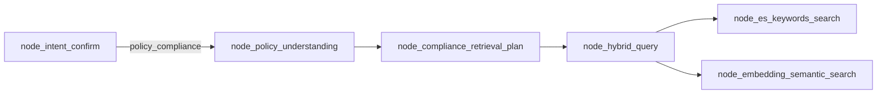
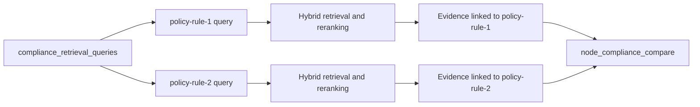

# `node_compliance_retrieval_plan`

## 1. Purpose

`node_compliance_retrieval_plan` converts the structured rules produced by
`node_policy_understanding` into legal-evidence retrieval requests.

It answers this planning question:

> Given what the policy permits, requires, or prohibits, what legal provisions,
> safeguards, procedures, responsibilities, exceptions, documentation, and
> evidence should the retrieval system look for?

The node is a planning and adaptation stage. It does not directly search
Elasticsearch, Milvus, or the web.

Implementation:

```text
app/query_process/agent/nodes/node_compliance_retrieval_plan.py
```

## 2. Position in the query workflow



An ordinary legal question bypasses this node:

```text
node_intent_confirm
  -> node_hybrid_query
```

A policy-compliance request uses it after policy understanding:

```text
node_intent_confirm
  -> node_policy_understanding
  -> node_compliance_retrieval_plan
  -> node_hybrid_query
```

This keeps policy decomposition separate from legal retrieval strategy.

## 3. Why the node is needed

A supplied policy is not necessarily a good legal search query.

Example policy:

```text
The document may be downloaded once and retained for 30 days for academic
research only.
```

Searching that sentence directly may retrieve documents containing similar
words, but it does not clearly express what evidence the compliance assessment
needs. The system must investigate questions such as:

- Is downloading permitted?
- Is a one-time-download restriction required or enforceable?
- Is 30-day retention lawful and proportionate?
- What safeguards apply to the document?
- What responsibilities and procedures are required?
- Must the organisation record, monitor, delete, or anonymise the document?
- Are there research-related exceptions or additional conditions?
- What evidence would demonstrate compliance?

`node_policy_understanding` identifies what the policy says.
`node_compliance_retrieval_plan` converts those policy statements into questions
about what applicable law requires.

## 4. Input state

The node reads the following `QueryGraphState` fields.

| Field | Required | Purpose |
|---|---:|---|
| `session_id` | Yes | Associates progress and logs with the current request. |
| `task_type` | Yes | Must be `policy_compliance`. |
| `policy_text` | Yes | Provides fallback text when no atomic rule is available. |
| `validated_policy_rules` | Yes | Contains source-grounded atomic policy rules. An empty list is allowed. |
| `policy_context` | Yes | Supplies validated organisations, roles, purposes, systems, jurisdictions, and related context. |
| `query_key_terms` | No | Existing intent-classification terms to merge with rule terms. |
| `is_stream` | No | Controls progress reporting. |

Typical input:

```json
{
  "session_id": "legal-123",
  "task_type": "policy_compliance",
  "policy_text": "The document may be downloaded once and retained for 30 days for academic research only.",
  "validated_policy_rules": [
    {
      "policy_rule_id": "policy-rule-1",
      "source_text": "The document may be downloaded once",
      "assignee": "",
      "action": "download",
      "asset": "The document",
      "rule_type": "permission",
      "constraint": "once",
      "purpose": "academic research",
      "selected_from": "independent_ai_fallback_enriched"
    },
    {
      "policy_rule_id": "policy-rule-2",
      "source_text": "retained for 30 days",
      "assignee": "",
      "action": "retain",
      "asset": "The document",
      "rule_type": "permission",
      "constraint": "30 days",
      "purpose": "academic research",
      "selected_from": "independent_ai_fallback_enriched"
    }
  ],
  "policy_context": {
    "purposes": [
      {
        "value": "academic research",
        "evidence": "for academic research only",
        "provenance": "explicit",
        "confidence": 1.0
      }
    ],
    "organisations": [],
    "legal_roles": [],
    "systems": [],
    "jurisdictions": [],
    "missing_context": []
  },
  "query_key_terms": [
    "one-time download",
    "30-day retention",
    "academic research"
  ]
}
```

## 5. Output state

The node returns a partial state update containing exactly the fields required
by current and future retrieval processing:

```json
{
  "compliance_retrieval_queries": [],
  "rewritten_query": "",
  "query_key_terms": []
}
```

### 5.1 `compliance_retrieval_queries`

This preserves one retrieval plan for every validated policy rule.

Each plan contains:

| Field | Meaning |
|---|---|
| `policy_rule_id` | Stable link back to the policy rule. |
| `policy_rule` | Complete validated rule used to create the plan. |
| `query` | Legal-evidence question for that rule. |
| `key_terms` | Lexical phrases derived from the rule. |

### 5.2 `rewritten_query`

The existing semantic and keyword search nodes accept one query string. The
planner therefore combines all rule-level queries into one bounded query for
the current retrieval implementation.

### 5.3 `query_key_terms`

Terms from intent classification and all policy-rule plans are merged,
deduplicated case-insensitively, and limited to 24 terms.

## 6. Planning algorithm

### 6.1 Extract validated context values

`_context_values()` flattens the validated `policy_context` structure into
unique phrases.

For example:

```json
{
  "purposes": [
    {"value": "academic research"}
  ],
  "jurisdictions": [
    {"value": "European Union"}
  ]
}
```

becomes:

```json
["academic research", "European Union"]
```

`missing_context` is deliberately excluded because it describes absent
information rather than facts that can safely constrain retrieval.

At most the first 12 validated context values are added to each query.

### 6.2 Render each rule as a description

`_rule_description()` builds a compact description in this order:

```text
rule type
  -> action
  -> asset
  -> assignee
  -> constraint
  -> purpose
```

Given:

```json
{
  "rule_type": "permission",
  "action": "retain",
  "asset": "The document",
  "assignee": "researcher",
  "constraint": "30 days",
  "purpose": "academic research"
}
```

the description is:

```text
permission to retain The document for assignee researcher subject to 30 days
for purpose academic research
```

Empty fields are omitted. If `rule_type` is absent, the neutral word `rule` is
used.

### 6.3 Build a legal-evidence query per rule

For every validated rule, the node asks:

```text
What applicable legal requirements, safeguards, responsibilities, procedures,
documentation, exceptions, and evidence govern this policy <rule description>?
```

This wording is intentionally broader than asking whether the policy is legal.
A useful compliance assessment needs substantive requirements and also the
procedures, records, controls, and evidence needed to demonstrate compliance.

### 6.4 Generate rule key terms

`_rule_key_terms()` generates candidates from:

```text
rule_type + action
action + asset
assignee
constraint
purpose
```

Example:

```json
[
  "permission retain",
  "retain The document",
  "researcher",
  "30 days",
  "academic research"
]
```

Empty and duplicate terms are removed.

### 6.5 Merge existing and generated terms

`_merge_key_terms()` preserves term order:

1. terms created during intent classification;
2. terms generated for policy rule 1;
3. terms generated for policy rule 2;
4. remaining rule terms until the limit is reached.

Deduplication is case-insensitive. For example, `Academic Research` and
`academic research` are treated as the same term.

### 6.6 Build the compatibility query

`_combined_retrieval_query()` begins with a general compliance-retrieval
instruction and appends every rule-specific query with its rule ID:

```text
Assess the applicable legal requirements for the supplied policy. Retrieve
provisions governing each policy rule, including required safeguards,
responsibilities, procedures, documentation, exceptions, and evidence.

policy-rule-1: What applicable legal requirements ... govern this download
permission ...?

policy-rule-2: What applicable legal requirements ... govern this retention
permission ...?
```

The result is limited to 8,000 characters because downstream search services
currently expect one manageable query string.

## 7. Complete example

Given two atomic policy rules, the node creates approximately:

```json
{
  "compliance_retrieval_queries": [
    {
      "policy_rule_id": "policy-rule-1",
      "policy_rule": {
        "action": "download",
        "asset": "The document",
        "rule_type": "permission",
        "constraint": "once",
        "purpose": "academic research"
      },
      "query": "What applicable legal requirements, safeguards, responsibilities, procedures, documentation, exceptions, and evidence govern this policy permission to download The document subject to once for purpose academic research? Relevant policy context: academic research.",
      "key_terms": [
        "permission download",
        "download The document",
        "once",
        "academic research"
      ]
    },
    {
      "policy_rule_id": "policy-rule-2",
      "policy_rule": {
        "action": "retain",
        "asset": "The document",
        "rule_type": "permission",
        "constraint": "30 days",
        "purpose": "academic research"
      },
      "query": "What applicable legal requirements, safeguards, responsibilities, procedures, documentation, exceptions, and evidence govern this policy permission to retain The document subject to 30 days for purpose academic research? Relevant policy context: academic research.",
      "key_terms": [
        "permission retain",
        "retain The document",
        "30 days",
        "academic research"
      ]
    }
  ],
  "rewritten_query": "Assess the applicable legal requirements for the supplied policy. Retrieve provisions governing each policy rule ...",
  "query_key_terms": [
    "one-time download",
    "30-day retention",
    "academic research",
    "permission download",
    "download The document",
    "once",
    "permission retain",
    "retain The document",
    "30 days"
  ]
}
```

The actual `policy_rule` objects retain all fields, including source evidence,
IDs, and extraction provenance.

## 8. No-rule fallback

An empty `validated_policy_rules` list does not stop legal retrieval. This can
happen when:

- neither extractor finds a deontic rule;
- extracted rules fail source-evidence validation;
- the input describes a general practice rather than an explicit permission,
  obligation, or prohibition.

The node creates one fallback plan:

```json
{
  "policy_rule_id": "policy-general",
  "policy_rule": {},
  "query": "Identify the applicable legal requirements, safeguards, responsibilities, procedures, documentation, and evidence for this policy text: ...",
  "key_terms": []
}
```

Validated context terms are still included when available.

This preserves retrieval capability without pretending that an atomic rule was
successfully extracted.

## 9. Validation and errors

The node checks its input before recording a running task:

| Invalid condition | Exception |
|---|---|
| Missing or empty `session_id` | `ValueError` |
| `task_type` is not `policy_compliance` | `ValueError` |
| Missing or empty `policy_text` | `ValueError` |
| `validated_policy_rules` is not a list | `TypeError` |
| `policy_context` is not a dictionary | `TypeError` |

During execution, the node:

- records a running progress task;
- logs the number of validated rules;
- creates the retrieval plans;
- records task completion;
- logs the number of generated plans and merged key terms;
- logs and re-raises unexpected exceptions.

## 10. Limits

```python
MAX_POLICY_RULES_FOR_RETRIEVAL = 50
MAX_COMBINED_QUERY_CHARACTERS = 8_000
MAX_COMPLIANCE_KEY_TERMS = 24
```

### `MAX_POLICY_RULES_FOR_RETRIEVAL`

Only the first 50 validated rules receive plans. This bounds state size and
combined-query construction for unexpectedly large policies.

### `MAX_COMBINED_QUERY_CHARACTERS`

The compatibility query is truncated to 8,000 characters. The individual
plans remain available in `compliance_retrieval_queries`.

### `MAX_COMPLIANCE_KEY_TERMS`

The merged lexical term list is limited to 24 entries to prevent noisy
Elasticsearch queries.

## 11. Current architectural limitation

The node creates one plan per policy rule, but the current retrieval nodes run
one combined search.

Current implementation:

```text
policy-rule-1 plan --+
                     +-> combined rewritten_query -> one hybrid retrieval
policy-rule-2 plan --+
```

Consequences:

- retrieved documents are not yet explicitly associated with a policy rule;
- a dominant rule may influence ranking more strongly than a less common rule;
- evidence coverage cannot yet be measured independently for every rule;
- a later compliance comparison must infer which evidence supports which rule.

## 12. Recommended future design

The stronger implementation should execute hybrid retrieval independently for
each rule:



A future result structure could be:

```json
{
  "policy_rule_id": "policy-rule-2",
  "retrieval_query": "...",
  "legal_evidence": [
    {
      "document": "General Data Protection Regulation",
      "provision": "Article 5(1)(e)",
      "text": "...",
      "reranker_score": 0.91
    }
  ],
  "retrieval_is_sufficient": true
}
```

This structure would allow `node_compliance_compare` to produce traceable
findings for every policy rule.

## 13. Relationship to later compliance comparison

The planner does not decide whether the policy complies with law. It only
defines what evidence must be found.

The future comparison stage should combine:

```text
validated policy rule
  + legal evidence retrieved for that rule
  + missing organisational context
  -> compliance finding
```

Expected finding categories include:

- requirement addressed;
- requirement partially addressed;
- missing requirement;
- policy-law conflict;
- ambiguous or unenforceable wording;
- operational measure not documented;
- insufficient legal evidence;
- recommended correction.

Keeping retrieval planning separate from compliance judgment prevents the
search node from prematurely deciding legal compliance.

## 14. Tests

Focused tests are in:

```text
app/test/test_node_policy_understanding.py
```

The retrieval-plan test verifies that:

- one plan is produced for each supplied rule;
- `policy_rule_id` is preserved;
- the combined query includes the rule ID;
- existing intent terms are retained;
- generated rule terms are added;
- progress callbacks are called.

Run the test module:

```bash
LOG_FILE_ENABLE=False .venv/bin/python -m unittest \
  app.test.test_node_policy_understanding
```

## 15. Summary

`node_compliance_retrieval_plan` is the bridge between policy understanding and
legal retrieval:

```text
What the policy says
  -> structured atomic rules
  -> legal-evidence questions for each rule
  -> current combined hybrid retrieval
  -> future rule-linked compliance comparison
```

It preserves rule-level plans for the stronger future architecture while also
producing the single query and key-term list required by the existing search
nodes.


---


  ### Position in the workflow

  node_intent_confirm
    → node_policy_understanding
    → node_compliance_retrieval_plan
    → node_hybrid_query
    → Elasticsearch and Milvus

  ### Input

  It reads:

  - policy_text
  - validated_policy_rules
  - policy_context
  - Existing query_key_terms
  - task_type, which must be policy_compliance

  Example validated rules:
```
  [
    {
      "policy_rule_id": "policy-rule-1",
      "action": "download",
      "asset": "The document",
      "rule_type": "permission",
      "constraint": "once",
      "purpose": "academic research"
    },
    {
      "policy_rule_id": "policy-rule-2",
      "action": "retain",
      "asset": "The document",
      "rule_type": "permission",
      "constraint": "30 days",
      "purpose": "academic research"
    }
  ]
```
  ### What the node does

  For each atomic policy rule, it creates a legal-retrieval request asking what legal provisions
  govern that rule.

  For example:
```
  {
    "policy_rule_id": "policy-rule-1",
    "query": "What applicable legal requirements, safeguards, responsibilities, procedures,
    documentation, exceptions, and evidence govern this policy permission to download The document
    subject to once for purpose academic research?",
    "key_terms": [
      "permission download",
      "download The document",
      "once",
      "academic research"
    ]
  }
```

  A separate plan is generated for retention:
```
  {
    "policy_rule_id": "policy-rule-2",
    "query": "What applicable legal requirements, safeguards, responsibilities, procedures,
    documentation, exceptions, and evidence govern this policy permission to retain The document
    subject to 30 days for purpose academic research?",
    "key_terms": [
      "permission retain",
      "retain The document",
      "30 days",
      "academic research"
    ]
  }
```
  ### Output

  The node returns three fields:
```
  {
    "compliance_retrieval_queries": [],
    "rewritten_query": "",
    "query_key_terms": []
  }
```
  #### compliance_retrieval_queries

  Preserves one retrieval plan for each policy rule:
```
  policy-rule-1 → download requirements
  policy-rule-2 → retention requirements
```
  This mapping will later allow retrieved legal provisions and compliance findings to be connected to
  the relevant policy rule.

  #### rewritten_query

  The existing search nodes currently accept only one query. Therefore, the node combines all rule-
  specific plans into one bounded query.

  This combined query is passed to:
```
  node_hybrid_query
    ├─ node_embedding_semantic_search
    └─ node_es_keywords_search
```
  #### query_key_terms

  The node merges:

  - Terms produced during intent classification
  - Rule types
  - Actions
  - Assets
  - Assignees
  - Constraints
  - Purposes

  Duplicate terms are removed, and the result is limited to 24 terms.

  ### Why this node is necessary

  Without it, retrieval would use only the original policy statement:

  The document may be downloaded once and retained for 30 days...

  That may retrieve documents discussing downloads or retention generally, but it does not clearly ask
  for:

  - Legal permissions and prohibitions
  - Required safeguards
  - Retention requirements
  - Documentation duties
  - Exceptions
  - Responsible roles
  - Evidence of compliance

  The planning node transforms policy language into legal-research questions.

  ### Current limitation

  Although the node creates one plan per policy rule, the existing retrieval implementation still
  performs one combined search.

  The current behavior is:
```
  multiple policy-rule plans
    → one combined query
    → one set of retrieval results
```
  The stronger future implementation should be:

  policy-rule-1 → separate hybrid retrieval → evidence for rule 1
  policy-rule-2 → separate hybrid retrieval → evidence for rule 2

  That would allow node_compliance_compare to compare every policy rule directly with its associated
  legal evidence.
