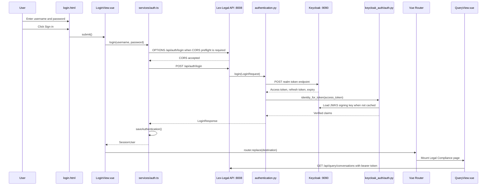

# Login Workflow and `auth_router` Matching

## 1. Purpose

This note explains how clicking **Sign in** in the Lex-Legal GUI reaches the
FastAPI authentication endpoint, how FastAPI matches `/api/auth/login` to
`auth_router`, how the backend authenticates with Keycloak, and how the
frontend stores and uses the resulting identity.

## 2. End-to-end sequence



## 3. Connecting `login.html` to `LoginView.vue`

The login component is implemented with a Vue script and an external HTML
template.

At the bottom of `lex-legal_frontend/src/views/LoginView.vue`:

```vue
<template src="../../templates/login.html"></template>
```

During the Vite build, Vue loads
`lex-legal_frontend/templates/login.html` as the component's template. Values
declared in the `<script setup>` section of `LoginView.vue` are automatically
available in that template.

The component declares:

```typescript
const username = ref('')
const password = ref('')
const errorMessage = ref('')
const submitting = ref(false)

const submit = async () => {
  // Authentication workflow
}
```

The template binds its input fields using `v-model`:

```html
<input v-model="username" />
<input v-model="password" type="password" />
```

Typing into these inputs updates `username.value` and `password.value` in
`LoginView.vue`.

The form connects its submit event to the component function:

```html
<form class="login-form" @submit.prevent="submit">
```

The **Sign in** button has `type="submit"`:

```html
<button type="submit">Sign in</button>
```

The event flow is therefore:

```text
Click Sign in
    -> button submits the form
    -> form emits submit
    -> @submit.prevent prevents a browser page reload
    -> Vue calls LoginView.vue submit()
```

## 4. `LoginView.vue` calls the frontend authentication service

`LoginView.vue` imports:

```typescript
import { login } from '../services/auth'
```

Its `submit()` function calls:

```typescript
const user = await login(username.value, password.value)
```

Before calling the service, it rejects empty fields and sets
`submitting.value = true`. The template reacts by disabling the button and
displaying `Signing in…`.

After success, it executes:

```typescript
await router.replace(destinationFor(user.is_admin))
```

After failure, it assigns the returned error to `errorMessage`, which the
template displays with `v-if="errorMessage"`.

## 5. Building the server URL

`lex-legal_frontend/src/services/api.ts` defines the API base URL:

```typescript
export const apiBase = (
  import.meta.env.VITE_API_BASE_URL
  || `${protocol}//${browserHost}:8008`
).replace(/\/+$/, '')
```

Docker Compose normally provides:

```text
VITE_API_BASE_URL=http://10.22.12.250:8008
```

`lex-legal_frontend/src/services/auth.ts` appends the authentication path:

```typescript
const response = await fetch(`${apiBase}/api/auth/login`, {
  method: 'POST',
  headers: { 'Content-Type': 'application/json' },
  body: JSON.stringify({
    username: username.trim(),
    password,
  }),
})
```

The resulting request is:

```http
POST http://10.22.12.250:8008/api/auth/login
Content-Type: application/json

{
  "username": "reader",
  "password": "user-password"
}
```

The frontend runs on port 5176 and the API runs on port 8008. Because different
ports are different browser origins, the browser may first issue an
`OPTIONS /api/auth/login` CORS preflight request. The CORS middleware in
`app/api/lex_legal_api.py` accepts the configured origin, methods, and headers.

## 6. Connecting to the FastAPI process

Uvicorn starts the unified API using:

```bash
uvicorn app.api.lex_legal_api:app \
  --host 0.0.0.0 \
  --port 8008
```

The command means:

- import the Python module `app.api.lex_legal_api`;
- retrieve the object named `app`;
- listen on every container network interface;
- accept HTTP traffic on port 8008.

Consequently, the request to `http://10.22.12.250:8008` enters the FastAPI
application created in `app/api/lex_legal_api.py`.

## 7. How `auth_router` creates `/api/auth/login`

FastAPI constructs the final route from three parts.

### 7.1 Application-level prefix

`app/api/lex_legal_api.py` includes the authentication router:

```python
app.include_router(
    auth_router,
    prefix="/api",
    tags=["Authentication APIs"],
)
```

This contributes:

```text
/api
```

### 7.2 Router-level prefix

`app/api/authentication.py` creates the router:

```python
auth_router = APIRouter(prefix="/auth")
```

This contributes:

```text
/auth
```

### 7.3 Endpoint path and method

The login function is decorated with:

```python
@auth_router.post("/login", response_model=LoginResponse)
async def login(request: LoginRequest) -> LoginResponse:
    ...
```

This contributes:

```text
POST /login
```

FastAPI combines them during application startup:

```text
Application prefix       /api
Router prefix            /auth
Endpoint path            /login
HTTP method              POST
                         ----------------
Registered route         POST /api/auth/login
```

The `tags` value does not participate in routing. It groups the endpoint under
**Authentication APIs** in Swagger.

## 8. How FastAPI matches the request

FastAPI uses Starlette routing internally. It does not first inspect the URL
and manually choose a router. `include_router()` expands all router endpoints
into the application's routing table when the application starts.

Conceptually, the routing table contains:

```text
POST /api/auth/login                      -> authentication.login
GET  /api/auth/me                         -> authentication.current_user
POST /api/auth/logout                     -> authentication.logout
POST /api/query                           -> query_server.query
GET  /api/query/conversations             -> query_server.conversations
POST /api/import/upload                   -> import_server.upload_files
```

For an incoming request, Starlette compares both:

1. the normalized URL path;
2. the HTTP method.

For this request:

```http
POST /api/auth/login
```

it finds the exact registered route and calls:

```python
authentication.login(request)
```

If the path exists but the method does not match, FastAPI returns
`405 Method Not Allowed`. If no path matches, it returns `404 Not Found`.

For example:

```text
POST /api/auth/login   -> matches
GET  /api/auth/login   -> 405 Method Not Allowed
POST /api/auth/unknown -> 404 Not Found
```

The request does not match `query_router` because that router is registered
under `/api/query`. It does not match `import_router` because that router is
registered under `/api/import`.

## 9. Parsing and validating the login request

FastAPI reads the JSON body and validates it against:

```python
class LoginRequest(BaseModel):
    username: str
    password: str
```

It then supplies the model to:

```python
async def login(request: LoginRequest) -> LoginResponse:
```

The endpoint:

1. trims the username;
2. checks that username and password are present;
3. reads the Keycloak settings;
4. builds a form-encoded token request;
5. sends the credentials to Keycloak.

## 10. Backend-to-Keycloak request

The Keycloak token request is built as:

```python
form_data = {
    "client_id": settings.login_client_id,
    "grant_type": "password",
    "scope": "openid profile email",
    "username": username,
    "password": request.password,
}
```

The configured login client is:

```text
lex-legal-web
```

The backend uses `httpx`:

```python
async with httpx.AsyncClient(timeout=15.0) as client:
    response = await client.post(settings.token_url, data=form_data)
```

The target is:

```text
http://10.22.12.250:9090/realms/dips_services/protocol/openid-connect/token
```

The user's password is forwarded only to Keycloak and is not saved in
MongoDB, application logs, or browser storage.

## 11. Keycloak token response

After successful authentication, Keycloak returns data similar to:

```json
{
  "access_token": "...",
  "refresh_token": "...",
  "expires_in": 300,
  "token_type": "Bearer"
}
```

When authentication fails, Keycloak returns an error. The Lex-Legal endpoint
converts it to an HTTP 401 response with a user-facing error message.

When Keycloak is unavailable, the endpoint returns HTTP 503.

## 12. JWT validation

After receiving the token, `authentication.login()` calls:

```python
identity = identity_for_token(access_token)
```

The function calls `decode_keycloak_token()` from
`keycloak_auth/auth.py`. Its call sequence is:

```text
identity_for_token(access_token)
    -> decode_keycloak_token()
        -> get_jwks_client(jwks_url)
        -> get_signing_key_from_jwt(token)
        -> jwt.decode(token, ...)
    -> identity_from_claims(claims)
```

The JWKS endpoint is:

```text
/realms/dips_services/protocol/openid-connect/certs
```

Signing keys are cached by JWKS URL. Token decoding validates:

- the cryptographic signature;
- the allowed algorithm, normally `RS256`;
- the `dips_services` issuer;
- the `lex-legal-api` audience;
- the token expiration time.

## 13. Building the Lex-Legal identity

`identity_from_claims()` maps the verified Keycloak claims into:

```python
AuthenticatedUser(
    subject=...,
    username=...,
    email=...,
    roles=...,
    groups=...,
    is_admin=...,
)
```

The relevant mappings are:

```text
sub                 -> stable user subject
preferred_username  -> displayed username
email               -> email address
realm_access.roles  -> realm roles
resource_access     -> relevant client roles
groups              -> Keycloak groups
```

`is_admin` becomes true when a role matches a configured Lex-Legal
administrator role, normally `admin` or `lexlegal-admin`.

## 14. Returning the response to the GUI

The backend returns a `LoginResponse`:

```json
{
  "access_token": "...",
  "refresh_token": "...",
  "token_type": "Bearer",
  "expires_in": 300,
  "expires_at": 1786110000000,
  "user": {
    "subject": "keycloak-subject-id",
    "username": "reader",
    "email": "reader@example.org",
    "roles": ["common-user"],
    "groups": [],
    "is_admin": false
  }
}
```

The frontend passes the response to `parseJsonResponse()` in
`services/api.ts`. This function parses JSON, converts unsuccessful HTTP
responses into JavaScript errors, and returns the typed response after
success.

## 15. Saving frontend authentication state

`services/auth.ts` calls:

```typescript
saveAuthentication(data)
```

This updates the reactive Vue state and stores:

```text
lexguard_access_token
lexguard_access_expires_at
```

in browser `localStorage`.

The backend currently returns a refresh token, but the frontend does not store
or use it. Consequently, an expired access token currently requires another
login.

## 16. Redirect after login

`LoginView.vue` retains the original protected destination from the route
query:

```text
/login?redirect=/legal-compliance
```

After login, it calls:

```typescript
router.replace(destinationFor(user.is_admin))
```

The route guard in `lex-legal_frontend/src/router.ts` calls
`restoreAuthentication()`. Because the reactive authentication state is now
authenticated, navigation is allowed.

Rules are:

- ordinary users can open `/legal-compliance`;
- administrators can also open `/import` and `/legal-query-monitor`;
- an ordinary user requesting an administrator route is redirected to
  `/legal-compliance`.

## 17. Authenticated requests after login

Protected frontend calls use `authenticatedFetch()`:

```typescript
const headers = new Headers(init.headers)
headers.set('Authorization', `Bearer ${authState.token}`)
const response = await fetch(input, { ...init, headers })
```

For example, after the Legal Compliance page mounts:

```http
GET /api/query/conversations?limit=100
Authorization: Bearer <access-token>
```

Protected FastAPI endpoints depend on:

```python
require_authenticated_user()
```

It:

1. reads the `Authorization` header;
2. requires the `Bearer` scheme;
3. validates the JWT again;
4. returns the `AuthenticatedUser` to the endpoint.

Administrator-only endpoints add:

```python
require_admin_user()
```

which returns HTTP 403 when `identity.is_admin` is false.

If an authenticated request returns HTTP 401, `authenticatedFetch()` clears
the browser authentication state and dispatches
`lexguard-authentication-required`. The application then redirects to the
login page.

## 18. Function call summary

```text
templates/login.html
└── @submit.prevent="submit"

views/LoginView.vue
└── submit()
    └── login(username, password)

services/auth.ts
└── login()
    ├── fetch(apiBase + "/api/auth/login")
    ├── parseJsonResponse()
    └── saveAuthentication()

services/api.ts
├── apiBase
└── parseJsonResponse()

app/api/lex_legal_api.py
└── include auth_router at "/api"

app/api/authentication.py
├── auth_router prefix "/auth"
└── login endpoint "/login"
    ├── KeycloakSettings
    ├── httpx.AsyncClient.post(token_url)
    ├── identity_for_token()
    │   ├── decode_keycloak_token()
    │   │   ├── get_jwks_client()
    │   │   └── jwt.decode()
    │   └── identity_from_claims()
    └── LoginResponse

views/LoginView.vue
└── destinationFor()
    └── router.replace()

router.ts
└── router.beforeEach()
    └── restoreAuthentication()

views/QueryView.vue
└── initializeConversations()
    ├── loadConversationList()
    └── loadHistory()
```

## 19. Main implementation files

| File | Responsibility |
|---|---|
| `lex-legal_frontend/templates/login.html` | Username/password inputs and form submit event |
| `lex-legal_frontend/src/views/LoginView.vue` | Login component state, `submit()`, errors, and post-login destination |
| `lex-legal_frontend/src/services/auth.ts` | Login request, browser token state, authorization header, logout, and 401 handling |
| `lex-legal_frontend/src/services/api.ts` | API base URL and JSON response handling |
| `lex-legal_frontend/src/router.ts` | Protected-route and administrator-route guards |
| `app/api/lex_legal_api.py` | Unified FastAPI application and router inclusion |
| `app/api/authentication.py` | Login endpoint, Keycloak token exchange, identity mapping, and authorization dependencies |
| `keycloak_auth/auth.py` | JWKS retrieval and JWT signature/issuer/audience validation |

