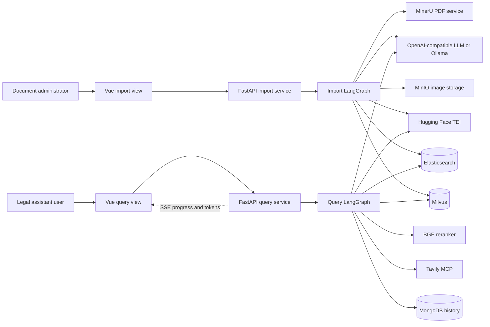
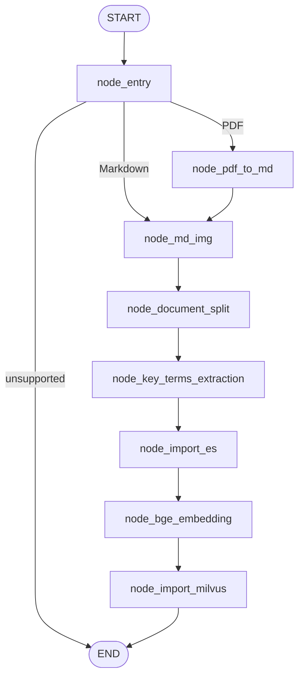
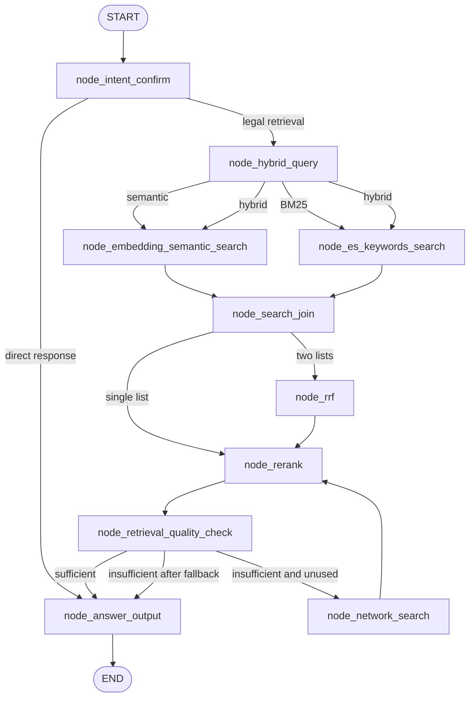

# Lex-Legal Project Architecture and Module Reference

## 1. Document purpose

This document describes the implemented Lex-Legal project as of 3 August 2026.
It covers the system architecture, runtime workflows, data contracts, packages,
modules, external services, frontend, configuration, testing, operations, and
known constraints.

The source code is the authority where older notes differ from this document.
The repository currently contains Markdown documentation and
`Lex-Legal_Architecture.jpg`; no `.docx` or `.doc` file is present in `docs/` or
elsewhere in the workspace.

## 2. Project overview

Lex-Legal is a legal Retrieval-Augmented Generation (RAG) application for
answering and assessing policy questions against a local corpus of EU law. Its
core design separates two concerns:

1. **Knowledge-base ingestion** converts PDF or Markdown legislation into
   traceable parent and child legal records, stores authoritative text in
   Elasticsearch, and stores child embeddings in Milvus.
2. **Legal querying** rewrites and classifies a user query, retrieves local
   evidence through BM25 and dense vector search, fuses and reranks the results,
   checks evidence quality, optionally performs one web fallback, and generates
   a sourced answer.

The application is composed of:

- a Python 3.11+ backend;
- two FastAPI services;
- two LangGraph workflows;
- Elasticsearch, Milvus, MongoDB, and MinIO integrations;
- MinerU PDF conversion and a TEI embedding endpoint;
- an OpenAI-compatible or local Ollama LLM integration;
- a BGE cross-encoder reranker;
- Tavily search through MCP as a bounded fallback;
- a Vue 3 and Vite frontend.

## 3. System context



### Architectural responsibilities

| Component | Responsibility |
|---|---|
| Vue frontend | Upload documents, submit queries, render streaming answers, show service health and local activity |
| Import API | Validate and save uploads, schedule import jobs, expose in-memory progress |
| Import graph | Convert, enrich, split, hash, embed, and persist legal documents |
| Query API | Accept synchronous or streaming queries, expose SSE and conversation history |
| Query graph | Plan retrieval, execute search, fuse, rerank, quality-gate, and answer |
| Elasticsearch | Authoritative parent and child legal text; BM25 retrieval and parent expansion |
| Milvus | Dense vectors and filterable metadata for child chunks only |
| MongoDB | Persistent conversation messages and query metadata |
| MinIO | Images extracted from Markdown/PDF conversion results |
| External model services | PDF conversion, image summarization, query analysis, key-term extraction, embeddings, reranking, and answer generation |

## 4. Repository layout

```text
lex-legal/
├── app/
│   ├── api/                 FastAPI import and query services
│   ├── clients/             External-service client adapters and managers
│   ├── config/              Environment and YAML-backed configuration
│   ├── core/                Cross-cutting logging
│   ├── entities/            Pydantic storage-record models
│   ├── import_process/      Import LangGraph, state, and ingestion nodes
│   ├── llm/                 LLM client creation and caching
│   ├── prompt/              Prompt-file loading and formatting
│   ├── query_process/       Query LangGraph, state, and retrieval nodes
│   ├── repositories/        Elasticsearch and Milvus persistence boundaries
│   ├── scripts/             Developer/batch commands
│   ├── test/                Backend unit and workflow tests
│   ├── tools/               Reserved package; currently empty
│   └── utils/               Hashing, SSE, task state, paths, formatting, and helpers
├── configs/                 Storage metadata schema
├── docs/                    Architecture and node documentation
├── law_doc/laws/            Authoritative Markdown law corpus
├── lex-legal_frontend/      Vue 3/Vite application and HTML templates
├── output/                  Generated per-import artifacts
├── prompts/                 LLM prompt templates
├── tests/                   Additional splitter regression tests
├── pyproject.toml           Python project metadata and dependencies
├── requirements.txt         Alternative dependency list
├── uv.lock                  Locked Python dependency graph
├── README.md                Project overview and primary run commands
└── main.py                  Placeholder hello-world entry point
```

Every `__init__.py` in the backend is currently an empty namespace marker. The
implementation lives in the modules described below.

## 5. Import architecture

### 5.1 Import graph

The compiled graph is `kb_import_app` in
`app/import_process/agent/import_main_graph.py`.



Elasticsearch import intentionally precedes embedding and Milvus import. This
makes authoritative text available independently from the vector store and
allows semantic hits to be enriched by `chunk_id` from Elasticsearch.

### 5.2 Import state

`ImportGraphState` is the mutable contract shared by import nodes. Important
field groups are:

| Group | Fields |
|---|---|
| Task identity | `task_id` |
| Input routing | `is_pdf_read_enabled`, `is_md_read_enabled` |
| Paths | `local_file_path`, `local_dir`, `pdf_path`, `md_path`, `file_title` |
| Document data | `md_content`, `document_hash`, `chunks` |
| Elasticsearch outcome | `es_import_success`, `es_index_name`, imported/stale counts, error |
| Embedding outcome | `embedding_success`, `embedded_count`, `embeddings_content`, error |
| Milvus outcome | `milvus_import_success`, collection name, imported/stale counts, error |
| General progress | `current_node`, `error_message` |

`get_default_state()` and `create_default_state()` deep-copy the default state
to prevent one import from reusing mutable lists created for another import.

### 5.3 Import stages

#### Entry and routing

`node_entry.py` validates `local_file_path`, detects lowercase `.md` or `.pdf`,
sets the matching path and enable flag, and derives `file_title`. Unsupported
input reaches graph end; the upload API already rejects unsupported extensions.

#### PDF conversion

`node_pdf_to_md.py` sends a PDF to MinerU, uploads to a service-provided URL,
polls for up to ten minutes, downloads the resulting ZIP, extracts it into the
task directory, locates the best Markdown candidate, and updates `md_path` and
`md_content`.

#### Markdown image processing

`node_md_img_process.py`:

1. reads Markdown and finds its adjacent `images/` directory;
2. selects referenced images with supported raster extensions;
3. extracts surrounding text for context;
4. asks the configured vision LLM for a description;
5. uploads the image to MinIO;
6. replaces the Markdown image reference with its hosted URL and description;
7. saves rewritten Markdown and updates state.

Markdown without a usable image directory continues without image enrichment.

#### Structure-aware legal splitting

`node_document_split.py` recognizes recitals, chapters/titles/parts, Articles,
numbered paragraphs, parenthesized definitions, lettered points, and Annexes.
It creates:

- a complete Article parent plus retrieval-oriented paragraph children;
- recital-group parents plus individual recital children;
- complete Annex parents plus grouped Annex children;
- deterministic fallback parent/child records for unsupported layouts.

The splitter normalizes records, validates unique IDs and parent references,
adds a shared `document_hash` and per-record `chunk_hash`, writes a timestamped
`chunks_*.json` backup, and publishes the list to `state["chunks"]`.

The current size policy is structure first:

| Constant | Current value | Use |
|---|---:|---|
| `CHILD_TARGET_TOKENS` | 512 | Preferred grouping size for unnumbered Article fallback and Annex blocks |
| `CHILD_HARD_MAX_TOKENS` | 700 | Prevent adding another generic block above this size |
| `POINT_GROUP_TARGET_TOKENS` | 400 | Preferred emitted size for a split oversized point range |
| `POINT_GROUP_MAX_TOKENS` | 550 | Keep point-based paragraphs intact up to this size; split larger ones at points |
| `TINY_PARAGRAPH_MAX_TOKENS` | 60 | Maximum individual plain-paragraph size eligible for adjacent grouping |
| `TINY_PARAGRAPH_GROUP_MAX_TOKENS` | 250 | Maximum combined body size for grouped tiny paragraphs |
| `TINY_PARAGRAPH_GROUP_MAX_BLOCKS` | 3 | Maximum tiny paragraphs in one child |
| `RECITAL_GROUP_SIZE` | 5 | Maximum individual recitals under one recital parent, subject to token limits |

The estimator counts words and punctuation; it is not an exact model tokenizer.
Complete legal blocks may exceed a limit when no safe structural boundary is
available.

#### Key-term extraction

`node_key_terms_extraction.py` sends child chunks without terms to an LLM in
batches of eight. It validates JSON results, removes legal-location references
that add little semantic value, deduplicates phrases, limits each child to eight
terms of at most 100 characters, and retries unresolved chunks in batches of
two and finally one. It writes `chunks_with_keywords.json` and preserves parent
records without unnecessary LLM calls.

#### Elasticsearch import

`node_import_es.py` validates and upserts every parent and child record. It
groups imported records by `law_id` and deletes stale Elasticsearch records for
the same law whose `document_hash` differs from the current version. Completion
metrics are written to import state.

#### Dense embedding

`node_bge_embedding.py` selects `child` and `parent_child` records only. Parent
Articles are not embedded. It validates the configured TEI dimension against
the Milvus schema, embeds child text in bounded batches, validates vector count,
dimension, numeric values, and finiteness, and converts results to the exact
Milvus entity schema. Authoritative text remains in Elasticsearch and is not
duplicated in Milvus.

#### Milvus import

`node_import_milvus.py` ensures the collection and index exist, validates every
embedding entity, upserts records by `chunk_id`, deletes stale vector records by
`law_id` and `document_hash`, and records import metrics in state.

### 5.4 Import entry points

There are two supported entry paths:

- `POST /upload` queues one FastAPI background task per uploaded file.
- `python -m app.scripts.build_rag_knowledge_base ...` imports a file or
  directory sequentially and writes a JSON batch report.

The CLI supports recursive discovery, `--non-recursive`, `--dry-run`,
`--fail-fast`, `--limit`, and a custom `--output-dir`. It rejects duplicate
derived `law_id` values in the same batch because the resulting primary keys
would overlap.

## 6. Query architecture

### 6.1 Query graph

The compiled graph is `query_app` in
`app/query_process/agent/query_main_graph.py`.



Hybrid semantic and BM25 branches run in parallel and return partial state
updates to different keys. `node_search_join` is the synchronization barrier;
this avoids concurrent writes to the same LangGraph state field.

### 6.2 Query state

`QueryGraphState` carries:

| Phase | Fields |
|---|---|
| Identity/input | `session_id`, `original_query`, `is_stream` |
| Planning | `history`, `rewritten_query`, `query_key_terms`, `search_type` |
| Retrieval | `semantic_searched_chunks`, `keywords_searched_chunks`, `network_searched_docs` |
| Ranking | `rrf_chunks`, `reranked_docs` |
| Quality/fallback | `retrieval_is_sufficient`, `retrieval_failure_reason`, `network_fallback_used` |
| Output | `answer`, `image_urls` |

### 6.3 Query stages

#### Intent analysis and rewriting

`node_intent_confirm.py` loads recent MongoDB history, asks the LLM for a
structured intent decision, rewrites follow-up questions into standalone
queries, extracts up to twelve legal key terms, and selects semantic, BM25, or
hybrid retrieval. Greetings, clearly unsupported requests, and clarification
needs can receive a direct answer without retrieval. Prompt history is limited
to ten messages and 8,000 characters.

#### Strategy validation

`node_hybrid_query.py` does not perform I/O. It validates that `search_type` is
one of `semantic_search`, `es_keywords_search`, or `hybrid_search`; the graph
router then starts the relevant branch or both branches.

#### Dense semantic retrieval

`node_embedding_semantic_search.py` embeds the rewritten query with the BGE
query prefix, searches Milvus for up to twenty active child records, and fetches
the corresponding authoritative documents from Elasticsearch by `chunk_id`.
The normalized hits retain vector scores for diagnostics while using ES text
for downstream evidence.

#### BM25 retrieval

`node_es_keywords_search.py` combines the rewritten query and unique extracted
terms, searches YAML-configured Elasticsearch fields, and normalizes up to
twenty results into the common retrieval shape. Configured boosts emphasize
Article number/title, law title, chapter title, and key terms over body text.

#### Search join and rank fusion

`node_search_join.py` validates branch outputs. A single retrieval list proceeds
directly to reranking. Hybrid results go to `node_rrf.py`, which performs
weighted Reciprocal Rank Fusion using:

```text
contribution = source_weight / (60 + rank)
```

Semantic and BM25 weights are currently both 1.0, and the ten best fused
candidates proceed to reranking. RRF compares ranks rather than incompatible
cosine and BM25 score scales.

#### Cross-encoder reranking

`node_rerank.py` merges and deduplicates local and optional web candidates,
loads a cached FlagEmbedding reranker, scores query/document pairs in a worker
thread, and normalizes results to descending scores. It retains at least three
and at most ten candidates, stopping early after an absolute score drop of 0.25
or a relative drop of 35 percent.

#### Evidence-quality gate

`node_retrieval_quality_check.py` fails closed when evidence is empty, scores
are malformed, results are not sorted, or the highest result has no recognized
source. Current acceptance thresholds are:

- local evidence: normalized reranker score at least 0.15;
- web evidence: normalized reranker score at least 0.35.

Web evidence requires a higher score because it is less controlled than the
locally ingested legal corpus.

#### One-time network fallback

`node_network_search.py` uses Tavily through an MCP Streamable HTTP connection.
It discovers the Tavily tool, requests up to five advanced-search results,
optionally restricts domains, normalizes structured or formatted responses, and
sets `network_fallback_used=True`. The graph permits only one fallback cycle,
preventing an infinite search loop.

#### Grounded answer output

`node_answer_output.py` has three paths:

1. publish a direct response created during intent analysis;
2. return a transparent insufficient-evidence message after failed local and
   network retrieval;
3. build a bounded evidence prompt and call the configured LLM.

The evidence prompt is limited to 12,000 characters. A deterministic source
appendix is added in code: local evidence identifies law, Article, and paragraph
and can disclose retrieved legal text; web evidence receives an explicit
non-authoritative warning and safe HTTP(S) links. The node persists user and
assistant messages in MongoDB, extracts referenced image URLs, stores the
non-streaming answer in task state, and publishes streaming deltas/final events
when requested.

## 7. Parent-child data model

### 7.1 Record roles

| Record type | Purpose | Elasticsearch | Milvus |
|---|---|---:|---:|
| `parent` | Complete Article, recital group, Annex, or document context | Yes | No |
| `child` | Precise retrievable paragraph, definition, recital, point range, or Annex part | Yes | Yes |
| `parent_child` | Short unit that can serve both roles | Yes | Yes |

A parent uses its own `chunk_id` as `parent_id`. Every child shares the stable
parent ID, enabling retrieval systems to find a precise passage and expand to
the complete Article when needed.

Example:

```json
{
  "chunk_id": "gdpr:article_6:paragraph_1",
  "parent_id": "gdpr:article_6",
  "law_id": "gdpr",
  "record_type": "child",
  "content_type": "article",
  "article_number": "6",
  "paragraph_start": "1",
  "paragraph_end": "1",
  "key_terms": ["lawfulness of processing", "consent"],
  "language": "en",
  "status": "in_force",
  "document_hash": "...",
  "chunk_hash": "...",
  "text": "Article 6\n\nLawfulness of processing\n\n1. Processing ..."
}
```

### 7.2 Stable IDs and hashes

- `chunk_id` is the Elasticsearch document ID and Milvus primary key.
- `parent_id` links a child to its authoritative context.
- `document_hash` fingerprints normalized source Markdown and is shared by all
  records from one version.
- `chunk_hash` fingerprints identity, structure, and authoritative chunk text.

Re-import is idempotent for the same IDs. Stale records for the same `law_id`
and a different `document_hash` are removed from both stores.

### 7.3 Elasticsearch schema

`configs/meta_config.yml` defines the authoritative schema and search behavior.
Fields include IDs, law/chapter/Article metadata, paragraph range, record and
content types, key terms, language, legal status, source file, hashes, and full
text. Searchable-field boosts are generated from this YAML rather than hardcoded
inside the repository.

### 7.4 Milvus schema

Milvus stores `chunk_id`, `parent_id`, law and provision metadata, key terms,
language, status, hashes, and `dense_vector`. It deliberately omits full text.
The vector dimension comes from `EMBEDDING_DIMENSION` and defaults to 768. The
configured index is HNSW with cosine similarity, `M=16`, and
`efConstruction=200`.

## 8. Backend package and module reference

### `app.api`

| Module | Responsibility |
|---|---|
| `lex_legal_api.py` | Unified FastAPI application, CORS, lifespan, health, OpenAPI groups, and router assembly |
| `import_server.py` | Import router: page, safe streamed uploads, task directories, background import execution, and status polling |
| `query_server.py` | Compliance router: chat page, synchronous/SSE query submission, graph execution, and history operations |

Import endpoints are `/health`, `/import`, `/upload`, and `/status/{task_id}`.
Query endpoints are `/health`, `/chat.html`, `/query`, `/stream/{session_id}`,
`/history/{session_id}`, and `DELETE /history/{session_id}`.

### `app.clients`

| Module | Responsibility |
|---|---|
| `embedding_utils.py` | LangChain-compatible TEI adapter, query prefixing, bounded concurrency, 429/503 backoff, and vector validation |
| `es_utils.py` | Reusable asynchronous Elasticsearch client manager; also contains legacy book-index examples |
| `milvus_utils.py` | Reusable asynchronous PyMilvus client manager |
| `minio_client.py` | Creates the configured MinIO client and bucket used for image objects |
| `mongo_utils.py` | Lazily initialized async MongoDB history storage, indexes, serialization, CRUD, and compatibility functions |
| `reranker_utils.py` | Lazy singleton loader for the configured FlagEmbedding reranker |

### `app.config`

| Module | Responsibility |
|---|---|
| `config_loader.py` | Loads and validates YAML through OmegaConf structured dataclasses |
| `embedding_config.py` | TEI endpoint, model, dimension, batching, normalization, retry, timeout, concurrency, and query-prefix configuration |
| `es_config.py` | Elasticsearch endpoint and index name |
| `llm_config.py` | LLM/VLM model names, API URL/key, temperature, and local-model flag |
| `meta_config.py` | Typed ES/Milvus field configuration, schema validation, record validation, ES mapping, and Milvus field helpers |
| `milvus_config.py` | Milvus URL, active and legacy collection names, timeout, and batch settings |
| `mineru_config.py` | MinerU base URL and API token |
| `minio_config.py` | MinIO endpoint, credentials, bucket, image prefix, and TLS flag |
| `mongodb_config.py` | MongoDB endpoint, database, and optional credentials |
| `reranker_config.py` | Reranker model path, device, and FP16 flag |

Most configuration modules load `.env` during import and expose one module-level
configuration object.

### `app.core`

`logger.py` configures Loguru console and daily file logging, retention, output
format, and caller-position correction. Logs are written under `logs/` when
file logging is enabled.

### `app.entities`

| Module | Responsibility |
|---|---|
| `es_record.py` | Dynamically builds the `ESRecordInfo` Pydantic model from YAML and defines typed `ESSearchResult` |
| `milvus_record.py` | Dynamically builds the `MilvusRecordInfo` Pydantic model from YAML |

Generating models from the shared metadata schema reduces drift between
validation, index creation, and persistence.

### `app.import_process`

| Module | Responsibility |
|---|---|
| `agent/state.py` | `ChunkRecord`, `MilvusRecord`, `ImportGraphState`, and fresh-state factories |
| `agent/import_main_graph.py` | Imports nodes, defines conditional file routing, compiles `kb_import_app` |
| `agent/nodes/node_entry.py` | File validation, type flags, path selection, and title derivation |
| `agent/nodes/node_pdf_to_md.py` | MinerU upload/poll/download/extract conversion workflow |
| `agent/nodes/node_md_img_process.py` | Image discovery, contextual vision summaries, MinIO upload, and Markdown rewriting |
| `agent/nodes/node_document_split.py` | Legal parser, parent-child chunking, metadata, hashes, validation, and backup |
| `agent/nodes/node_key_terms_extraction.py` | Batched structured LLM term extraction with validation and bounded retries |
| `agent/nodes/node_import_es.py` | Elasticsearch import orchestration and stale-version deletion |
| `agent/nodes/node_bge_embedding.py` | Child selection, TEI embeddings, vector/schema validation, Milvus-record conversion |
| `agent/nodes/node_import_milvus.py` | Milvus collection preparation, upsert, stale deletion, and metrics |
| `agent/nodes/node_import_qdrant.py` | Empty placeholder; Qdrant is not part of the active architecture |

### `app.llm`

`llm_utils.py` creates cached model clients keyed by model and JSON mode. It
supports OpenAI-compatible `ChatOpenAI` endpoints and a local `ChatOllama`
helper. JSON mode requests a `json_object` response format for structured nodes.

### `app.prompt`

`load_prompt.py` reads `prompts/<name>.prompt`, verifies existence, and applies
Python `str.format` substitution with node-provided variables.

### `app.query_process`

| Module | Responsibility |
|---|---|
| `agent/state.py` | Query state contract and fresh-state factory |
| `agent/query_main_graph.py` | Graph construction, routing functions, parallel fan-out, one-fallback loop, compiled `query_app` |
| `agent/nodes/node_intent_confirm.py` | History loading, intent classification, standalone rewrite, term extraction, and direct-answer routing |
| `agent/nodes/node_hybrid_query.py` | Search-strategy validation without I/O |
| `agent/nodes/node_embedding_semantic_search.py` | Query embedding, Milvus search, and ES text enrichment |
| `agent/nodes/node_es_keywords_search.py` | Boosted Elasticsearch BM25 retrieval |
| `agent/nodes/node_search_join.py` | Parallel branch synchronization and single/hybrid preparation |
| `agent/nodes/node_rrf.py` | Weighted reciprocal-rank fusion by stable chunk ID |
| `agent/nodes/node_rerank.py` | Candidate normalization, deduplication, cross-encoder scoring, top-k and score-gap trimming |
| `agent/nodes/node_retrieval_quality_check.py` | Source-aware relevance threshold and fail-closed routing decision |
| `agent/nodes/node_network_search.py` | One Tavily MCP fallback with result normalization |
| `agent/nodes/node_answer_output.py` | Safe answer selection/generation, deterministic sources, Mongo history, image URLs, and SSE output |

### `app.repositories`

| Module | Responsibility |
|---|---|
| `es/es_repository.py` | Index creation/mapping updates, YAML/Pydantic validation, bounded bulk upsert, stale deletion, BM25 search, and multi-get |
| `milvus/milvus_repository.py` | Schema/index construction, existing-schema compatibility checks, collection creation, hash-field migration, bounded upsert, stale deletion, ID fetch, and vector search |
| `mongodb/__init__.py` | Reserved namespace; Mongo implementation currently lives in `clients/mongo_utils.py` |
| `redis/__init__.py` | Reserved namespace; Redis is not implemented or used |

Repositories isolate storage-specific behavior from graph nodes. Graph nodes own
workflow state and progress; repositories own persistence contracts.

### `app.scripts`

`build_rag_knowledge_base.py` is the operational batch importer. It discovers
supported documents deterministically, derives law IDs, rejects collisions,
imports documents sequentially, verifies ES and Milvus completion, converts
exceptions into per-file results, and atomically writes a batch JSON report.

### `app.utils`

| Module | Responsibility |
|---|---|
| `content_hash.py` | Canonical text normalization and SHA-256 document/chunk hashes |
| `draw_mermaid_png.py` | Writes a LangGraph Mermaid diagram PNG |
| `escape_milvus_string_utils.py` | Escapes string values used in Milvus filter expressions |
| `format_utils.py` | JSON and import-state formatting helpers |
| `normalize_sparse_vector.py` | L2 normalization for non-zero sparse-vector values; currently outside the dense retrieval path |
| `path_util.py` | Project-root discovery and path helpers |
| `rate_limit_utils.py` | Sliding-window request limiter utility |
| `sse_utils.py` | Per-session in-memory queues, SSE event packing, publishing, streaming, and cleanup |
| `task_utils.py` | Per-task in-memory status, running/done stages, results, and optional SSE progress publishing |

### `app.test` and `tests`

Backend tests cover configuration, metadata schemas, import API behavior, batch
imports, Mongo history, every active storage/import node, query routing, search
normalization, RRF, reranking, quality checks, answer output, and network result
normalization. `tests/test_node_document_split.py` adds focused synthetic and
real-law splitter regressions.

## 9. Frontend package reference

The frontend uses Vue 3 Composition API, Vue Router, TypeScript, Vite, `marked`
for Markdown rendering, and DOMPurify for sanitization.

| File/module | Responsibility |
|---|---|
| `src/main.ts` | Creates the Vue application, installs the router, loads global CSS |
| `src/App.vue` | Application shell, navigation, responsive menu, and 15-second API health polling |
| `src/router.ts` | Routes for overview, legal query, knowledge import, and monitor views |
| `src/services/api.ts` | Unified API base URL, JSON error handling, and health checks |
| `src/services/activityStore.ts` | Browser-local query activity history, capped at 200 records |
| `src/views/HomeView.vue` | Product overview and navigation |
| `src/views/ImportView.vue` | Drag/drop and file-picker uploads, per-task polling, progress, and error display |
| `src/views/QueryView.vue` | Session handling, Mongo history loading, synchronous/SSE queries, token rendering, sanitized Markdown, and activity recording |
| `src/views/MonitorView.vue` | Local activity filtering, counts, success rate, p95 latency, details, and clearing |
| `src/styles.css` | Shared visual system and responsive styles |
| `templates/*.html` | Vue external templates and legacy standalone pages served by backend routes |
| `vite.config.ts` | Vite/Vue build configuration |

The frontend defaults to the unified API on port 8008. It can be overridden
with `VITE_API_BASE_URL` at build/development time.

## 10. Prompt package

| Prompt | Consumer and purpose |
|---|---|
| `rewritten_query_and_key_terms.prompt` | Intent node: classify, rewrite, extract terms, select retrieval strategy |
| `answer_out.prompt` | Answer node: grounded legal analysis from evidence and history |
| `image_summary.prompt` | Markdown image node: contextual image description |
| `hyde_prompt.prompt` | HyDE experiment; not part of the active query graph |
| `key_term_extraction.prompt` | Earlier item-name workflow support; not in the active graph |
| `product_recognition_system.prompt` | Empty placeholder |

Key-term extraction currently embeds its system instructions directly in
`node_key_terms_extraction.py` rather than loading a prompt file.

## 11. API behavior

### Unified API service

Recommended command:

```bash
uvicorn app.api.lex_legal_api:app --host 0.0.0.0 --port 8008
```

`POST /api/import/upload` accepts one or more `.md`/`.pdf` files, sanitizes each filename,
streams it to `output/<YYYYMMDD>/<task-id>/`, returns HTTP 202, and schedules a
background graph run. Clients poll `/api/import/status/<task-id>`.

### Compliance query routes

`POST /api/query` accepts:

```json
{
  "query": "When is personal-data processing lawful?",
  "session_id": "optional-conversation-id",
  "is_stream": true
}
```

Non-streaming requests wait for the graph and return the answer. Streaming
requests return the session ID immediately; the browser then connects to
`GET /api/query/stream/{session_id}`. SSE event types include progress, token delta,
final answer, and error.

Authenticated conversation navigation is persisted in MongoDB. The
`chat_conversation` collection stores each session's Keycloak subject, title,
and created/updated timestamps, while `chat_message` stores the chronological
messages. The API exposes:

- `GET /api/query/conversations` to list the current user's chats;
- `POST /api/query/conversations` to create a new chat;
- `DELETE /api/query/conversations/{session_id}` to delete an owned chat;
- `GET /api/query/history/{session_id}` to reopen an owned chat.

Query submission, SSE streaming, history access, and deletion all validate
the session owner. Missing sessions and sessions owned by another user both
return HTTP 404 to avoid revealing another user's conversation identifiers.

## 12. Configuration and deployment dependencies

Do not commit `.env`; it contains service locations and credentials. Main
configuration groups are:

| Area | Environment variables |
|---|---|
| LLM/VLM | `OPENAI_BASE_URL`, `OPENAI_API_KEY`, `OPENAI_MODEL_NAME`, `VL_MODEL`, `LLM_DEFAULT_TEMPERATURE`, `LOCAL_MODEL` |
| Embedding/TEI | `EMBEDDING_HOST`, `EMBEDDING_PORT`, `EMBEDDING_MODEL`, `EMBEDDING_DIMENSION`, batch/timeout/retry/concurrency variables, `EMBEDDING_QUERY_PREFIX` |
| Elasticsearch | `ES_URL`, `ES_INDEX_NAME` |
| Milvus | `MILVUS_URL`, `CHUNKS_COLLECTION`, legacy collection-name variables, `MILVUS_TIMEOUT`, `MILVUS_BATCH_SIZE` |
| MongoDB | `MONGO_BASE_URL`, `MONGO_DB_NAME`, `MONGO_USERNAME`, `MONGO_PASSWORD` |
| MinIO | `MINIO_ENDPOINT`, `MINIO_ACCESS_KEY`, `MINIO_SECRET_KEY`, `MINIO_BUCKET_NAME`, `MINIO_IMG_DIR`, `MINIO_SECURE` |
| MinerU | `MINERU_BASE_URL`, `MINERU_API_TOKEN` |
| Reranker | `BGE_RERANKER_MODEL_PATH`, `BGE_RERANKER_DEVICE`, `BGE_RERANKER_FP16` |
| Tavily MCP | `TAVILY_API_KEY`, optional MCP URL/timeout/domain settings |
| APIs/CORS | `LEXLEGAL_CORS_ORIGINS` (with legacy query/import CORS fallbacks) |
| Logging | console/file enablement and levels, retention |

The TEI output dimension, `EMBEDDING_DIMENSION`, and Milvus vector schema must
match. The code checks this contract before import and query embedding.

### Typical local processes

```text
Vue/Vite frontend       :5176
Unified Lex-Legal API   :8008
TEI embedding service   :8083 by default
Elasticsearch           configured by ES_URL
Milvus                  :19530 by default
MongoDB, MinIO, MinerU  configured by environment
```

## 13. Generated artifacts

Depending on the input path and document content, an import work directory can
contain:

- the uploaded source;
- MinerU result ZIP and extracted files;
- normalized or image-rewritten Markdown;
- extracted images;
- timestamped `chunks_*.json` splitter backups;
- `chunks_with_keywords.json`;
- CLI batch import report.

`output/` is operational data rather than application source.

## 14. Reliability, safety, and observability

Implemented safeguards include:

- filename normalization and extension allowlisting;
- empty-upload rejection and bounded upload reads;
- deterministic legal IDs and duplicate-ID validation;
- parent-reference validation;
- document/chunk hashing and stale-version removal;
- YAML/Pydantic schema validation before persistence;
- embedding dimension, count, numeric, and finiteness validation;
- bounded TEI concurrency and retry for overload responses;
- Milvus existing-schema checks and confirmed upsert/delete counts;
- one network fallback maximum;
- source-aware evidence thresholds;
- no LLM legal answer after all evidence checks fail;
- HTTP(S)-only web links and sanitized rendered Markdown;
- structured progress logs and frontend-visible stages.

## 15. Important current constraints

1. **Task tracking and SSE queues are process-local memory.** They are not
   durable, are lost on restart, and are not shared across multiple API workers.
   A production deployment needs Redis or another shared task/event backend.
2. **FastAPI background tasks are not a durable job queue.** A process crash can
   lose an import or streaming query. Long production jobs should use a worker
   system with retries and persistence.
3. **The legal parser is deterministic Markdown parsing, not Akoma Ntoso, ELI,
   or a complete legal grammar.** OCR and conversion errors can still affect
   boundaries.
4. **The query service allows wildcard CORS.** Production should use explicit
   trusted origins, as the import service already supports.
5. **`main.py` is a placeholder.** Despite an older run note, `python main.py`
   does not start either API. Use the explicit Uvicorn commands.
6. **The query server's direct `__main__` port is 8005, while the frontend and
   documented deployment use 8008.** Prefer the Uvicorn command for consistency.
7. **Import graph construction draws a Mermaid PNG at module import time.** This
   is an avoidable filesystem/network-capable side effect and should be moved to
   an explicit developer command.
8. **PDF conversion uses synchronous HTTP and polling.** It can occupy a worker
   thread for a long document.
9. **`node_import_qdrant.py`, Redis/Mongo repository namespaces, sparse-vector
   utility, and some prompts are placeholders or inactive paths.** They should
   not be represented as active production capabilities.
10. **Changing chunk thresholds changes IDs, hashes, embeddings, and retrieval
    behavior.** Rebuild both stores after such a change.

## 16. Development and verification

Install locked dependencies with the project's chosen `uv` workflow or the
virtual environment, then run backend tests without contacting live services
where mocks are provided:

```bash
.venv/bin/python -m unittest discover -s app/test -v
.venv/bin/python -m unittest discover -s tests -v
```

Build the frontend with:

```bash
cd lex-legal_frontend
npm ci
npm run build
```

Inspect a knowledge-base plan without external calls:

```bash
.venv/bin/python -m app.scripts.build_rag_knowledge_base \
  law_doc/laws --dry-run
```

Run a real import only after Elasticsearch, Milvus, TEI, the LLM endpoint, and
any input-specific services are configured:

```bash
.venv/bin/python -m app.scripts.build_rag_knowledge_base \
  law_doc/laws --output-dir output/laws_build
```

## 17. Design rationale summary

- **Legal structure before token size:** paragraphs and points carry legal
  meaning; token thresholds are safeguards, not arbitrary cut positions.
- **Parent text plus child vectors:** precise child retrieval is combined with
  complete Article context without duplicating all parent vectors.
- **Shared stable IDs:** Elasticsearch and Milvus results can be joined and
  fused reliably.
- **Separate lexical and semantic retrieval:** exact legal language and semantic
  paraphrases are both supported.
- **RRF before cross-encoding:** incompatible raw scores are fused by rank, then
  a common reranker score drives evidence selection and quality checks.
- **Fail closed on evidence:** the system prefers an explicit limitation over an
  unsupported legal conclusion.
- **One bounded web fallback:** current information can be sought when local
  evidence is weak without creating an uncontrolled retrieval loop.
- **Schema-driven persistence:** one YAML metadata contract drives validation,
  mappings, vector schema, and typed records.

## 18. Related documents

- `README.md` — concise project introduction and run commands.
- `docs/Lex-Legal_Architecture.jpg` — high-level visual architecture.
- `docs/chunk_doc.md` — detailed chunk-threshold behavior.
- `docs/law_doc_splite.md` — earlier splitter implementation notes; some
  historical values may be stale.
- `docs/node_key_terms_extraction.md` — key-term extraction details.
- `docs/node_bge_embedding.md` — embedding-stage details.
- `docs/node_import_es.md` — Elasticsearch import details.
- `docs/node_import_milvus.md` — Milvus import details.
- `docs/0.run_api.md` — older run notes; use the commands in this document and
  the root README where they conflict.
