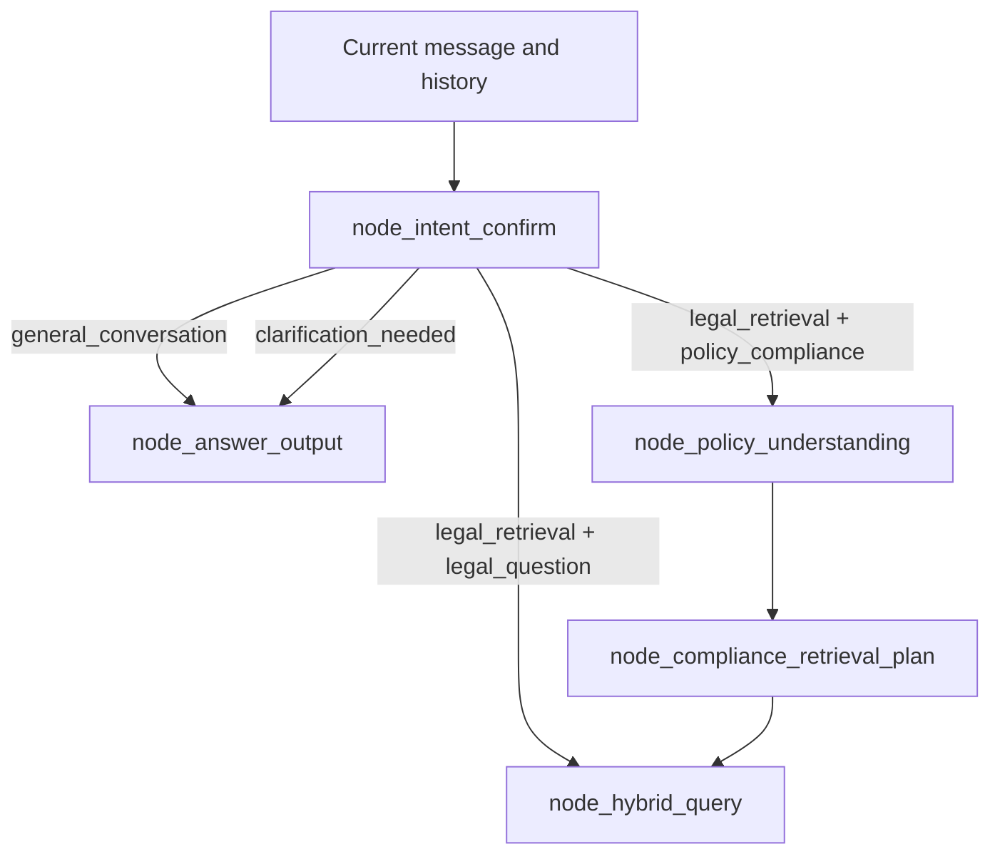

# Question and Intent Classification

## 1. Purpose

`node_intent_confirm` is the entry point of the Lex-Legal query workflow. It
decides whether the current message requires legal evidence, needs clarification,
or can be answered directly as general conversation.

The classifier returns one of three intents:

| Intent | Meaning | Retrieve legal evidence? |
|---|---|---:|
| `legal_retrieval` | A substantive legal, regulatory, or policy-compliance request. | Yes |
| `clarification_needed` | The request may be legal, but essential meaning is missing. | No, wait for clarification |
| `general_conversation` | A greeting, thanks, capability question, or clearly non-legal message. | No |

`legal_retrieval` is divided into two task types:

| Task type | Meaning |
|---|---|
| `legal_question` | Explain what the law permits, prohibits, requires, or means. |
| `policy_compliance` | Assess supplied policy wording, a process, contract, rule, or technical practice. |

Intent and task type are separate concepts. Intent decides whether retrieval is
needed. Task type decides whether policy understanding must happen before
retrieval.

## 2. Classification model

The normalized classifier result has this shape:

```json
{
  "intent": "legal_retrieval",
  "task_type": "legal_question",
  "policy_text": "",
  "query_key_terms": ["legal concept"],
  "rewritten_query": "A standalone retrieval question",
  "direct_answer": ""
}
```

The fields mean:

| Field | Purpose |
|---|---|
| `intent` | Selects retrieval, clarification, or direct conversation. |
| `task_type` | Selects ordinary legal retrieval or policy-compliance processing. |
| `policy_text` | Exact supplied policy or practice wording to assess. |
| `query_key_terms` | Up to twelve concise concepts for retrieval. |
| `rewritten_query` | Standalone query with resolvable conversational references expanded. |
| `direct_answer` | Clarification question or brief conversational response. Empty for retrieval. |

## 3. `legal_retrieval`

Use `legal_retrieval` when answering the user requires legal or regulatory
evidence. This includes both ordinary legal questions and policy-compliance
assessments.

For every `legal_retrieval` result:

```json
{
  "intent": "legal_retrieval",
  "direct_answer": ""
}
```

An empty `direct_answer` tells the graph to continue instead of responding
immediately.

### 3.1 Ordinary legal question

An ordinary legal question asks what the law says, permits, prohibits,
requires, or means. It does not supply organisational wording or a practice for
assessment.

Examples:

- “How long may personal data be retained under the GDPR?”
- “What obligations does a data controller have?”
- “Can personal data be processed for academic research?”
- “What does Article 5 GDPR require?”
- “Does the EU Data Act apply to connected products?”
- “What remedies are available following a breach of contract?”

Classification:

```json
{
  "intent": "legal_retrieval",
  "task_type": "legal_question",
  "policy_text": "",
  "query_key_terms": ["personal data", "retention", "GDPR"],
  "rewritten_query": "How long may personal data be retained under the GDPR?",
  "direct_answer": ""
}
```

Its processing path is:

```text
User question
  -> hybrid legal retrieval
  -> fusion and reranking
  -> evidence-quality check
  -> legal explanation
```

There is no supplied policy rule to decompose, so ODRL extraction and policy
reconciliation are unnecessary.

### 3.2 Policy-compliance assessment

A policy-compliance assessment asks whether supplied policy wording, a process,
contract, rule, or technical practice follows applicable law.

Examples:

- “Assess this retention policy for GDPR compliance: personal data is kept
  while the business needs it.”
- “Is this data-sharing rule compliant?”
- “Review our employee-monitoring policy.”
- “Our company keeps customer information for as long as the business needs
  it. Is this sufficient?”
- “Compliance the policy: The document may be downloaded once and retained for
  30 days for academic research only.”
- “Check whether employees may upload customer records to this system.”
- A self-contained policy statement pasted into the compliance GUI.

Classification:

```json
{
  "intent": "legal_retrieval",
  "task_type": "policy_compliance",
  "policy_text": "The document may be downloaded once and retained for 30 days for academic research only.",
  "query_key_terms": [
    "one-time download",
    "30-day retention",
    "academic research"
  ],
  "rewritten_query": "Policy compliance assessment: The document may be downloaded once and retained for 30 days for academic research only.",
  "direct_answer": ""
}
```

Its processing path is:

```text
Supplied policy or practice
  -> ODRL endpoint extraction
  -> independent AI extraction
  -> validation, comparison, and reconciliation
  -> per-rule compliance retrieval planning
  -> hybrid legal retrieval
  -> legal evidence for later compliance comparison
```

### 3.3 Mandatory policy-compliance signals

Classify the message as `policy_compliance` when any of the following applies:

1. It supplies policy, contract, process, rule, or practice wording and asks to
   check, assess, review, audit, validate, or determine compliance.
2. It uses an imperfect command such as “compliance the policy,” “compliance
   check this,” or “check compliance of this policy.”
3. It labels text as policy wording and supplies that text after a colon.
4. It supplies a self-contained normative rule defining permitted, required,
   or prohibited conduct.
5. It describes an organisation's actual practice and asks whether that
   practice is legally sufficient.

For example, this bare statement is treated as a policy rule in this
application:

```text
The document may be retained for 30 days.
```

### 3.4 Extracting `policy_text`

`policy_text` should contain only the wording or practice being assessed.
Instruction prefixes should be removed.

Input:

```text
Compliance the policy: The document may be downloaded once and retained for
30 days for academic research only.
```

Extracted value:

```text
The document may be downloaded once and retained for 30 days for academic
research only.
```

The classifier must not invent policy wording, a named law, jurisdiction, legal
role, or missing organisational fact.

### 3.5 Ordinary question versus compliance assessment

| Characteristic | Ordinary legal question | Policy-compliance assessment |
|---|---|---|
| Intent | `legal_retrieval` | `legal_retrieval` |
| Task type | `legal_question` | `policy_compliance` |
| Main input | A question about law | Policy, rule, process, contract, or practice |
| Objective | Explain applicable law | Evaluate supplied wording or conduct |
| `policy_text` | Empty | Required |
| ODRL extraction | Not used | Used |
| Independent AI extraction | Not used | Used |
| Retrieval basis | Rewritten legal question | Validated atomic policy rules |
| Comparison with policy | Not required | Required in the complete architecture |
| Expected answer | Evidence-grounded legal explanation | Findings, gaps, conflicts, and corrections |

Compare these two inputs:

```text
What GDPR rules govern research-data retention?
```

This is an ordinary legal question because the user asks what the law says.

```text
Check this policy: research data is retained for 30 days.
```

This is policy compliance because the user supplies wording for assessment.

## 4. `clarification_needed`

Use `clarification_needed` when the message may concern a legal or compliance
matter, but essential meaning cannot be recovered from either the current
message or conversation history.

Examples:

- “Is this allowed?” when no earlier message identifies what “this” means.
- “Does it apply?” when no law, rule, product, organisation, or activity is
  identifiable.
- “Check our policy” when no policy text, file, or policy reference was
  provided.
- “What about the exception?” when the conversation contains several unrelated
  exceptions and no unique referent.
- “Is the retention okay?” when neither the retained information nor retention
  period is known.

Example result:

```json
{
  "intent": "clarification_needed",
  "task_type": "legal_question",
  "policy_text": "",
  "query_key_terms": [],
  "rewritten_query": "Check whether the unidentified policy is compliant.",
  "direct_answer": "Please provide the policy wording you want assessed."
}
```

The direct answer must be one short, specific clarification question. It should
ask only for the information needed to continue.

Good clarification:

```text
Which policy wording or practice would you like me to assess?
```

Less useful clarification:

```text
Please provide more information.
```

The first version identifies exactly what is missing.

### 4.1 When not to request clarification

Do not classify a message as `clarification_needed` merely because:

- the user did not name the applicable law;
- the jurisdiction is unknown but relevant law can still be retrieved or the
  absence can be reported;
- the policy omits a responsible organisation or legal role;
- the request contains informal grammar but its meaning is clear;
- a substantive legal question can be conservatively rewritten without
  inventing facts.

Missing policy details may themselves be compliance findings. The classifier
should not prevent analysis simply because the policy is incomplete.

### 4.2 Conversation history and reference resolution

The classifier receives up to ten recent MongoDB messages, bounded to 8,000
characters. It may resolve references only when the history supplies an
unambiguous meaning.

History:

```text
User: What does Article 5 GDPR require?
Assistant: ...
```

Current message:

```text
Does it also govern retention?
```

This can be rewritten as an ordinary legal retrieval question about Article 5
GDPR because “it” has a clear referent.

If the history discusses GDPR, the EU Data Act, and the AI Act, the message
“Does it apply?” remains ambiguous and should request clarification.

## 5. `general_conversation`

Use `general_conversation` when the message does not need legal-document
retrieval.

Typical categories include:

- greetings;
- thanks and acknowledgements;
- capability questions;
- requests for help using the interface;
- clearly non-legal conversation.

Examples:

- “Hello.”
- “Thank you, that was helpful.”
- “What can you do?”
- “Can you analyse uploaded policies?”
- “How do I start a new compliance assessment?”
- “Tell me a joke.”

Example result:

```json
{
  "intent": "general_conversation",
  "task_type": "legal_question",
  "policy_text": "",
  "query_key_terms": [],
  "rewritten_query": "What can this assistant do?",
  "direct_answer": "I can answer legal and regulatory questions and help assess supplied policies against relevant legal requirements."
}
```

`direct_answer` should be brief and helpful. It may describe the assistant's
legal and regulatory scope, but it must not give a substantive legal conclusion
without retrieval.

### 5.1 Legal-sounding capability questions

A message can contain legal words without requiring legal retrieval:

```text
Can you analyse GDPR policies?
```

This asks about system capability, not GDPR requirements, so it is
`general_conversation`.

Compare:

```text
Can a controller retain personal data indefinitely under the GDPR?
```

This asks for a legal conclusion and is `legal_retrieval` with task type
`legal_question`.

## 6. Routing behaviour



Routing uses two state values:

```python
if state.get("answer"):
    return "node_answer_output"
if state.get("task_type") == "policy_compliance":
    return "node_policy_understanding"
return "node_hybrid_query"
```

For clarification and general conversation, `node_intent_confirm` places the
short response in `state["answer"]`. For legal retrieval, `answer` is empty.

## 7. Rewritten-query rules

The classifier should:

- preserve the user's meaning;
- produce a standalone query;
- resolve pronouns only from unambiguous history;
- preserve named laws, jurisdictions, citations, quoted terms, and important
  constraints;
- avoid answering the legal question;
- avoid inventing a law, jurisdiction, fact, date, article, or intention.

Original:

```text
Does it require deletion?
```

History identifies “it” as GDPR Article 5. A valid rewrite is:

```text
Does GDPR Article 5 require deletion of the personal data in question?
```

Without that historical context, inserting GDPR would be an unsupported
invention.

## 8. Key-term rules

The classifier returns no more than twelve unique terms. Useful terms include:

- named laws and regulations supplied by the user or history;
- regulated activities;
- legal roles;
- rights and duties;
- remedies;
- data or asset categories;
- legal concepts relevant to the supplied question.

Good examples:

```json
["lawful basis", "personal data", "data controller", "retention"]
```

Avoid:

- greetings and filler words;
- generic question words;
- full sentences;
- dates or article numbers as standalone terms;
- laws and concepts unsupported by the query or history.

For example, the classifier must not add `GDPR` merely because a policy mentions
data. Applicable-law determination belongs to later compliance analysis.

## 9. Normalization and defensive behaviour

The node validates the model response before updating graph state:

- unknown intent labels default conservatively to `legal_retrieval`;
- only `legal_question` and `policy_compliance` are accepted task types;
- `policy_compliance` is accepted only with `legal_retrieval`;
- missing policy text falls back to the original query for a policy assessment;
- `policy_text` is cleared for other task types;
- duplicate and empty key terms are removed;
- key terms are limited to twelve;
- `direct_answer` is always cleared for legal retrieval;
- clarification and conversation receive a safe default response when the
  model leaves `direct_answer` empty;
- invalid or non-object JSON raises an explicit error.

## 10. Classification decision table

| User message | Intent | Task type | Reason |
|---|---|---|---|
| “What does GDPR Article 5 require?” | `legal_retrieval` | `legal_question` | Requests an explanation of law. |
| “Check this policy: data is retained for 30 days.” | `legal_retrieval` | `policy_compliance` | Supplies policy wording for assessment. |
| “Data may be shared with approved researchers.” | `legal_retrieval` | `policy_compliance` | Self-contained normative rule. |
| “Is this permitted?” with a clear referent in history | `legal_retrieval` | `legal_question` or `policy_compliance` | History resolves the task. |
| “Is this permitted?” without context | `clarification_needed` | `legal_question` | Essential referent is missing. |
| “Review our policy” without text or attachment | `clarification_needed` | `legal_question` | The object of assessment is missing. |
| “Thanks.” | `general_conversation` | `legal_question` | No evidence retrieval is needed. |
| “Can you assess contracts?” | `general_conversation` | `legal_question` | Capability question. |
| “May a processor reuse customer data?” | `legal_retrieval` | `legal_question` | Substantive legal question. |
| “Our processor reuses customer data. Check compliance.” | `legal_retrieval` | `policy_compliance` | Organisational practice supplied for assessment. |

For non-retrieval intents, `task_type="legal_question"` is a neutral default;
it does not route to legal retrieval because `direct_answer` is already present.

## 11. Implementation references

| Component | Location |
|---|---|
| Classification prompt | `prompts/rewritten_query_and_key_terms.prompt` |
| Intent node | `app/query_process/agent/nodes/node_intent_confirm.py` |
| Graph routing | `app/query_process/agent/query_main_graph.py` |
| Query state | `app/query_process/agent/state.py` |
| Intent tests | `app/test/test_node_intent_confirm.py` |
| Graph-routing tests | `app/test/test_query_main_graph.py` |

The policy-understanding implementation is documented separately in
`docs/2.query_policy_understand_implement.md`.
